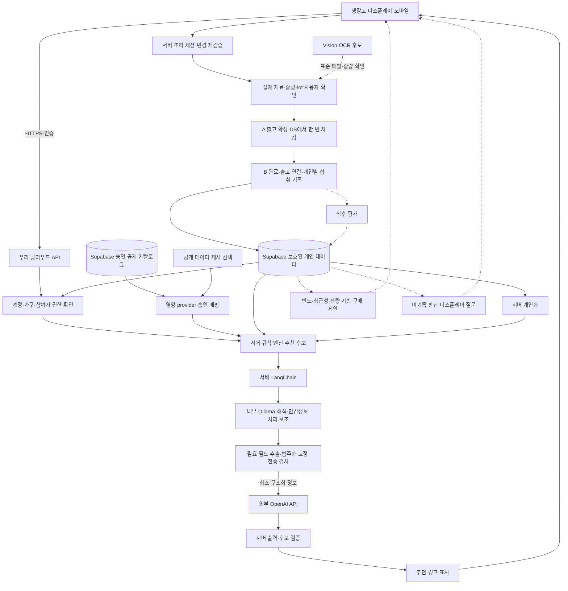

# KINI 메인 페르소나 기준 AI DB 전체 파이프라인 설계 v1

작성·코드 확인일: 2026-11-26 (한국 시간)

코드 기준: 초기 점검 main `96fc3d2`, 추가 최신 원격 main `672106468124ee75d6962abb3cabda80d78e6e09`의 가족 등록·조회 인증 변경까지 확인

범위: 설계 문서만 작성. 서버·화면·DB migration·Figma 수정 없음.

**v1의 목표는 클라우드 중심 서비스다.** 냉장고·모바일은 입력·표시를 맡고, 우리가 관리하는 서버에서 API·규칙 엔진·LangChain·Ollama를 실행한다. 가족·건강·재고·식사 기록을 포함한 서비스 DB는 Supabase로 이전한다. 현재 main의 SQLite·로컬 AI 코드는 재사용·이전할 기반이며, 이 문서의 목표 배치와 현재 구현 상태를 구분한다. 별도 v2를 만들지 않고 이 v1을 사용자의 최신 방향으로 수정했다.

비용 원칙: 새 유료 구독을 전제로 하지 않는다. 무료 DB·서버 한도와 보유 API 크레딧을 먼저 확인하고, 초과 시 자동 과금 대신 호출·적재를 제한한다. 호스팅 업체와 실제 계정의 무료 자원 확보 여부는 아직 미확정이다.

**설계 상태: v1 작성 완료.** 발표 운영 목표는 2026-12-22 종료까지다. [배포·연결 명세](클라우드_배포_연결_명세_v1.md)에 서버 배치·DB 이전 계약·권한·AI 경계·운영 예산을 확정했다. 이후 구현·배포·실측은 별도 완료 단위이며 v1 작성의 잔여 작업이 아니다.

## 1. 목표와 완료 범위

가족의 식사와 영양을 관리하는 **가족 영양 관리자**를 메인 페르소나로 한다. 근거는 [기존 역할 문서](https://github.com/Dajeong0315/KINI/blob/96fc3d2d02d598e41729216612370d468c11b508/docs/3%EC%9D%B8_%EC%97%AD%ED%95%A0%EB%B6%84%EB%8B%B4_%EB%B0%8F_%ED%86%B5%ED%95%A9%EC%88%9C%EC%84%9C.md)의 페르소나 정의다. 특정 이름·나이·질환·가족 구성은 새로 가정하지 않는다. 열람한 Figma 시나리오에는 개인 이름 예시가 있지만 이를 메인 페르소나의 확정 인물 정보로 간주하지 않는다.

대표 사용 상황은 이번 끼니에 먹을 가족을 선택하고, 현재 재고와 사용자가 설정한 식사 제한에 맞는 메뉴를 고른 다음, 실제 조리 재료·사용량과 개인별 섭취량을 기록하는 것이다. 성공 결과는 재고가 A 출고 확정에서 한 번만 감소하고, 식사·섭취 영양이 목표 구조의 Supabase에 저장되며 이후 추천의 개인화 근거로 이어지는 상태다.

이번 단계의 완료 조건은 전체 흐름의 입력·처리·저장·출력·실패 처리와 담당 경계를 설명하고, 기존 구현과 신규·후속 범위를 구분하는 것이다. 신규 기능 구현이나 운영 모델 선정은 이 설계의 완료 조건에 포함하지 않는다. Figma 원문 시나리오와 코드의 대조 결과도 8절에 기록한다.

상태 표기는 다음과 같다.

- **기존:** 기준 main에서 코드가 확인된 경로. 전체 제품 완성을 뜻하지 않는다.
- **부분:** 코드·API는 있으나 화면 연결 또는 시나리오 일부가 빠진 경로.
- **신규:** 이번 멘토링을 반영해 설계한 다음 개발 대상. 아직 구현하지 않았다.
- **후속:** 현재 구현 단위 밖의 확장. 완료된 기본 흐름을 미완료로 되돌리는 조건이 아니다.

## 2. 확정한 서비스 원칙

1. 메인 페르소나를 우선 시연하고 서브 페르소나는 후속 확장한다.
2. 구매 제안은 사용 빈도·최근성·현재 잔량을 모두 사용한다. 자동 주문은 구현하지 않고 Coming Soon 또는 B2B 확장 범위로 남긴다.
3. 반출 감지는 사용·섭취 확정이 아니다. 표준 재료 매핑과 실제 중량 확인 후 출고를 확정하고 섭취는 별도 기록한다.
4. 선제적 질문은 냉장고 디스플레이에서 서비스 내 미기록 상태와 이용 기록을 기준으로 제공한다. 문 열림 센서 제작·연동·가상 문 열림 이벤트는 범위 밖이다. 모바일 푸시도 후속이다.
5. 식후 평가의 맛·간·난이도는 분리한다. 사용자의 평가가 알레르기·영양 등 안전 규칙을 우회하지 않는다.
6. 개인정보를 포함한 서비스 DB는 동의와 권한에 따라 Supabase에 저장한다. 공개 카탈로그와 개인 데이터의 접근 정책을 분리한다. 원본 음성·이미지·대화·검진표는 필요한 경우에만 목적·보관 기간을 정하고 영구 보관을 기본으로 하지 않는다. 비밀번호·접근 토큰 원문을 일반 데이터 테이블에 저장하지 않는다.
7. 최종 추천 안전 판단은 우리가 관리하는 서버의 규칙 엔진이 한다. 기존 규칙의 기능과 우선순위는 유지하고 실행 위치를 서버로 옮긴다. AI는 안전 판정이나 의료 처방을 대신하지 않는다.
8. LangChain과 Ollama는 우리 서버 내부 서비스다. OpenAI 등 외부 AI에 보내기 직전 필요한 정보만 추출하고 식별자 제거·범주화·고정 allowlist 검사를 수행한다. 개인정보가 우리 클라우드 DB에 존재하는 것과 외부 AI에 전달하는 것은 별도 경계다.
9. 기기·앱과 서버는 인증된 HTTPS로 통신하고 서버 내부 DB·Ollama 접근을 제한한다. 사용자의 Wi-Fi 연결 의도는 이 인증된 서비스 통신으로 구현한다. 실제 LG ThinQ에 연결하지 않는다.

## 3. 전체 연결 구조

아래는 **v1의 목표 구조**다. 클라우드 배포는 신규이며 기존 기능 로직을 옮겨 사용한다. 점선은 신규 기능의 연결 위치다.

LangChain은 처리 순서를 연결하는 계층이고 Ollama는 모델 실행 서비스다. 모델에 DB 전체 접근 권한을 주지 않는다. 서버가 권한을 검사해 필요한 범위만 조회한다. 보안 차단은 Ollama 판단만으로 해제할 수 없고 결정적 필터·허용 목록을 반드시 통과해야 한다.

선택한 메뉴의 부족분은 현재 `purchase_allowed`와 `purchase_missing_g`로 다루지만, 이는 장기 사용 패턴 기반 구매 제안 기능과 다르다. 인식 경로의 입고는 A `stock_in` 확인으로, 반출은 A `stock_out` 확인으로 연결한다.

## 4. 현재 핵심 파이프라인

아래 표는 main의 **이전 전 구현 현황**이다. SQLite·로컬이라는 표현은 현재 코드 설명이며 목표 저장 정책은 6절의 Supabase 구조다. 기능 완료와 클라우드 이전 완료를 구분한다.

| 단계·상태 | 입력 | 처리·API | 읽기·저장 위치 | 출력·실패 처리 |
|---|---|---|---|---|
| 1 로그인·기존 | 로그인명·비밀번호·가구 | `POST /api/auth/login` | local_accounts, account_households, auth_sessions | Bearer 토큰. 잘못된 자격은 401. 브라우저 토큰은 탭 메모리만 사용 |
| 2 가족·참여자·기존 | 가구와 이번 끼니 참여자 | `GET /api/members`, `POST /api/meal-sessions` | members와 제한·선호·목표, meal_sessions, meal_session_participants | 참여자 세션. 최신 main에 등록·가구/구성원 생성 API 추가. 전체 초기 설정·초대·편집 화면은 미연결 |
| 3 재고·기존 | 인증 가구 | `GET /api/data/inventory` | inventory_items, inventory_sync_state, inventory_events | 재고·버전·확인 대기 수. 화면에서 조회 실패를 빈 재고로 위장하지 않음 |
| 4 후보·영양·기존 | 참여자·끼니·시간·제외 조건·구매 허용 | recommendation_engine → data_quality → RecommendationNutritionProvider | recipes, recipe_ingredients, 개인 조건, 승인 카탈로그 링크와 영양 | 하드 필터 후 점수. 불확실한 영양·안전 정보는 제외·확인 처리 |
| 5 AI 경계·기존 | 로컬에서 검증된 후보와 최소 구조화 조건 | PrivacyGateway → 선택 AI client → 응답 코드 검증 | 외부에는 일회성 후보·제약 코드와 허용 영양 요약만 | 개인정보 차단은 privacy_blocked, AI 실패·형식 오류는 api_error. 후보는 숨김 |
| 6 추천 표시·기존 | `POST /api/recommendations` 결과 | 후보·경고 표시, 시작 전 GET 재검증 | recommendation_requests, recommendation_candidates | 유효 POST는 상태와 별개로 201. 오래된 결과는 stale_unvalidated |
| 7 조리·기존 | 추천 후보·동일 참여자 세션 | cooking-sessions 생성·조회·ingredients 변경 | cooking_sessions, planned_servings, ingredients_json | 변경한 총량으로 1인분 영양 재계산. 실패 시 변경 보존 안 함 |
| 8 출고·기존 | 최신 조리 재료 총량·선택 lot·사용자 확인 | events 접수 → confirm | inventory_events, inventory_event_changes, inventory_items, 버전 | UUID 멱등성·동시 출고 검사. 여기서만 재고 차감. 부족·충돌은 409 |
| 9 섭취·기존 | Bearer·inventory_event_ids·개인별 servings | cooking-sessions/id/complete | cooking_inventory_event_links, meal_records, meal_record_items, nutrition_intakes | 출고 재사용·미확정 거절, 401/403/409 처리. 재고를 다시 차감하지 않음 |
| 10 저장 확인·기존 | 성공한 완료 응답 | C report 화면 | 응답 목록은 탭 메모리, 실제 기록은 SQLite | 현재 탭 저장 결과만 표시. 과거·기간별 리포트 조회는 없음 |
| 11 다음 추천·부분 | 선택·거절·섭취·재료 선호 신호 | personalization 집계·점수, 기존 feedback API | preference_evidence, inferred_preferences, household_behavior_summary | 기존 추천에 증거 반영. C의 구조화 식후 평가 화면은 미연결 |

### 단위와 트랜잭션

- `nutrition_per_serving`: 1인분 영양. 열량 kcal, 주요 영양 g, 나트륨 mg.
- `planned_servings`: 새 세션은 참여자당 1인분을 기본으로 잡은 조리 인분. 기존 null 세션은 원본 레시피 인분 적용.
- `ingredients[].quantity_g`: 이번 조리 전체 사용량. 화면의 기존 ‘레시피 전체’ 문구는 이 의미로 해석한다. 인분 수 명시 표시는 후속 UX 정리 대상이다.
- `items[].servings`: 구성원별 실제 섭취 인분. 개인 섭취 영양은 1인분 영양 × 실제 인분이다. 서버는 0인분을 허용하고 선호 증거로 만들지 않는다. C는 미섭취자를 제외하고 모두 0이면 저장하지 않는다.
- A 출고와 B 완료는 **서로 다른 트랜잭션**이다. B 실패가 이미 확정된 A 출고를 자동 취소하지 않는다. 같은 탭에서는 기존 UUID·출고 ID로 재시도하고, 새로고침 후 자동 복구와 부분 출고 혼합 편집은 후속이다.
- 계획 조리량과 실제 총 섭취량의 초과·남은 음식 정책은 별도 계약 대상이다. 현재 main의 완료 경로를 전체 소비량 보존 모델로 간주하지 않는다.

## 5. AI 역할과 실제 실행 상태

아래는 main의 현재 동작이다. 목표는 LangChain·Ollama·규칙을 우리 클라우드 서버로 이전하는 것이며, 기존 fake 기본 설정과 모델 선정 보류를 실제 클라우드 AI 완성으로 표시하지 않는다. 서버의 모델 원문 표시 여부는 기존 출력 검증 정책을 유지한 상태에서 별도 기능 계약으로 정한다.

| 기능 | main 실제 동작 | 설계상 역할·한계 |
|---|---|---|
| 추천 후보 선택·안전 | 로컬 규칙과 점수로 수행 | LLM이 새 메뉴·재료·안전 판정을 확정하지 않음 |
| 개인정보 보호 | deterministic 필터와 allowlist, 전송 직전 wire_schema | Ollama 검토 인터페이스는 선택적이다. 모든 호출이 Ollama 검사를 거친다고 표시하지 않음 |
| 추천 AI client | 기본 FakeOpenAIRecommendationClient. `KINI_USE_OPENAI=1`일 때 외부 client | 외부 client는 최소 payload만 받음. API 호출 활성화는 이 설계 작업에서 하지 않음 |
| 설명 표시 | AI 응답의 후보 코드 집합을 검증하고 자유 문장은 버림. local_template 표시 | ‘AI 자연어 설명이 화면에 그대로 표시됨’은 현재 사실이 아님 |
| Ollama·STT·TTS | 기존 로컬 음성·해석 서비스와 API 존재 | 현재 C 추천·조리 화면의 녹음·음성 확인 전체 경험은 미연결. 별도 JSON 재고 채팅도 핵심 SQLite 흐름과 구분 |
| RAG·조리 질문 | 기존 로컬 문서 검색·조리 질문 경로 | 일반 조리 안내 보조. 원문 시나리오는 레시피 고정 표시와 필요할 때만 대화가 기준이며 자동 단계 낭독을 요구하지 않음 |
| Vision·OCR | main 전체 흐름 미연결, Vision 별도 브랜치 | 표준 재료·중량 확인 후 로컬 A 이벤트로 연결. 실제 정확도·Unknown 성능은 별도 평가 |
| 모델 평가 | 합성 사례 3개로 로컬 모델 3종 비교 보고 | 평가 준비 산출물은 완료. 운영 모델 선정·외부 모델 비교·자연어 품질 검증은 보류 |

추천 후보의 레시피 목록은 현재 로컬 `recipes`·`recipe_ingredients`를 조회한다. 공개 식약처 레시피 전체가 자동 추천 후보로 투영된 것은 아니다. 병합된 provider는 우선 **재료 영양 공급 계약**이다.

## 6. 목표 DB와 외부 AI 데이터 경계

### 저장·실행 위치

| 영역 | 목표 위치 | 연결·보호 기준 |
|---|---|---|
| 화면 | 냉장고·모바일 브라우저 | 입력·표시·탭 상태. DB 관리자 키나 Ollama 주소를 직접 사용하지 않음 |
| 인증·가구 권한 | 우리 서버와 Supabase | 모든 개인 데이터 경로에서 계정·가구·역할 검사. Supabase Auth 활용 여부는 이전 계약에서 확정 |
| 가족·건강·재고·식사·개인화 | Supabase PostgreSQL 보호 영역 | 가구·구성원 단위 권한과 RLS·서버 검사를 함께 설계. 개인 영역의 공개 읽기 금지 |
| 식품·레시피·공식 데이터 | Supabase 공개 카탈로그 영역 | 승인 published·release·명시적 매핑 원칙 유지. ‘공개 정보’와 DB 무제한 공개를 구분 |
| 서비스 API·규칙·조리·개인화 | 우리 클라우드 서버 | 기존 Python 로직 재사용. 클라이언트가 DB를 임의 변경해 규칙을 우회하지 못하게 함 |
| LangChain·Ollama | 우리 클라우드 연산 서버 | 내부 접근만 허용. OpenAI와 별도의 처리 경계. 서버 모델의 입력에도 필요한 최소 정보만 사용 |
| 외부 OpenAI | 범주화·최소화된 요청만 전송 | 이름·고정 개인 ID·계정·토큰·원문 건강·음성·대화·상세 재고 이력 제외 |
| Redis/memory | 초기에는 선택적인 공개 읽기 캐시 | 기존 공개 캐시 정책 유지. 개인 데이터 캐시를 새로 만들지 않음 |
| 원본 음성·이미지·검진표 | 필요 시 우리 서버 처리와 Supabase 비공개 Storage | 동의·권한·보관 기한·삭제 설계 후 사용. 공개 버킷과 원본 외부 AI 전송을 기본으로 하지 않음 |
| 운영 로그·LangChain 추적 | 원문 제거한 서버 운영 정보 | 프롬프트·도구 응답·DB 결과·토큰이 외부 추적 서비스에 자동 전송되지 않도록 설정·검증 |

### 외부 전송 처리

1. 클라우드 저장·서비스 처리 동의와 외부 AI 처리 안내를 목적별로 정리한다. 동의 범위를 저장하고 철회·삭제 경로를 설계한다.
2. 서버가 인증된 사용자의 가구·참여자 데이터만 읽는다.
3. 서버 규칙 엔진이 정확한 제약과 영양·재고를 판단한다. 이 판단에 필요한 원본 정확도는 내부에서 유지한다.
4. 외부 설명에 실제 필요한 필드만 새 객체로 구성한다. 나이가 필요하면 ‘37세 → 30대 후반’처럼 범주화하고 필요 없으면 나이 자체를 빼며, 이름·DB ID는 일회성 코드로 치환하거나 제외한다.
5. 상세 질환·검진 수치는 외부 전송하지 않고 필요한 사용자 설정 식사 제약만 허용 코드로 축약한다. 드문 조건 조합은 더 줄이거나 전송을 차단한다.
6. deterministic allowlist·형식 검사를 통과한 요청만 OpenAI로 보낸다. Ollama는 탐지·축약을 보조하며 단독 승인자가 아니다.
7. 출력은 후보·사실·규칙을 다시 검증한 뒤 화면에 제공한다. 실패하면 기존 api_error/privacy_blocked와 후보 숨김 원칙을 유지한다.

범주화만으로 완전한 익명화를 보장했다고 표시하지 않는다. 목표는 외부 전송 정보의 최소화와 재식별 위험 감소다. OpenAI API는 명시적 데이터 공유 opt-in이 없으면 기본적으로 학습에 사용하지 않지만, 보관·로그 정책은 별개이므로 사용하는 endpoint의 저장 설정도 확인한다. [공식 데이터 정책](https://developers.openai.com/api/docs/guides/your-data)

### SQLite에서 Supabase로 이전할 범위

- 기존 계정·가구·참여자·재고·조리·섭취·선호 관계를 PostgreSQL schema와 접근 정책에 대응시킨다. SQLite SQL을 연결 주소만 바꿔 그대로 실행하지 않는다.
- SQLite의 BEGIN IMMEDIATE·멱등성·출고 연결의 의미를 PostgreSQL 트랜잭션·행 잠금·유일 제약·서버 처리로 옮긴다. A 출고만 차감하고 B 완료는 연결·기록만 하는 원칙을 유지한다.
- 공개 데이터 stage/validate/publish/rollback과 승인 매핑을 재사용한다. 요청 중 외부 식품 API를 실시간 호출하지 않는다.
- 이전 전 백업과 시험 데이터 변환을 만들고 건수·참조 무결성·재고·영양 결과를 비교한다. 전환 시 쓰기 원본은 하나로 정한다. 양쪽 DB에 무조건 이중 기록하지 않는다.
- 전체 개인 API 권한 검사를 먼저 보강하고, 로그·모델 endpoint·DB 접근을 확인한다. 기존 로컬 데모를 그대로 인터넷에 공개하지 않는다.
- 네트워크 실패 시 저장 성공으로 표시하지 않는다. 이벤트 UUID와 재시도로 중복 출고·섭취를 막는다. 오프라인 쓰기 큐는 후속 계약이며 현재 지원으로 표시하지 않는다.
- 서버 업체·지역·메모리·기존 계정 이용 가능 여부, 인증 이전 방식·동의 화면 문구·보관 기간은 아직 미정이다. 실제 데이터 이전·외부 호출·계정 가입은 이번 작업에 포함하지 않는다.

### 무료 한도 우선 배치안

조사일: 2026-11-26. 다음은 공식 제공 조건을 확인한 후보이며 실제 계정 자원 확보·배포 검증 결과가 아니다.

| 구성 | 우선 검토안 | 제약·미확인 |
|---|---|---|
| DB | 기존 Supabase Free 프로젝트 활용 | 공식 안내상 DB 500 MB, 파일 1 GB. 공개 카탈로그·새 개인 테이블·원본 파일 총량을 실제로 측정. 휴면·전송량 한도 확인 필요 |
| API·LangChain·Ollama 서버 | 무료 VM 또는 교육·기관의 서버 크레딧을 우선 검토 | OCI Always Free Arm VM은 후보. 현재 공식 안내의 2 OCPU·12 GB 해당 한도, 지역 용량·회수 정책·모델 호환과 응답 시간 확인 필요. 확보와 성능을 보장하지 않음 |
| 소형 웹 호스팅 | Render Free는 API 단독 후보 | 512 MB급 서버에 기존 3B/4B Ollama까지 함께 올리는 안은 채택하지 않음. 15분 무요청 시 휴면, workspace 월 750시간 등 한도 |
| 외부 AI | 실제 계정의 지급·교육·구독 혜택 API 크레딧 확인 후 제한 사용 | ChatGPT와 API 과금은 별도. 일부 구독의 API 크레딧 혜택도 대상·잔액·만료를 확인해야 하며 보유를 가정하지 않음 |
| 개발·테스트 | 기존 fake client와 합성 데이터 | 실제 시연 AI와 구분. 무료 크레딧 부족 시 유료 호출·충전을 자동으로 실행하지 않음 |

무료 GPU를 필수 전제로 잡지 않는다. CPU 소형 양자화 모델·요청 직렬 처리로 시연 가능한지 측정한다. 무료 연산 서버 확보에 실패하면 유료 구독부터 하지 않고 지원 크레딧을 확인한다. 기존 PC를 서버로 사용하는 안은 임시 대안이며 ‘전부 클라우드 배치 완료’로 부르지 않는다.

출처: [Supabase 요금](https://supabase.com/pricing), [Render Free](https://render.com/docs/free), [Render 자원 안내](https://render.com/articles/from-side-project-to-production-scaling-your-first-app), [OCI Always Free](https://docs.oracle.com/en-us/iaas/Content/FreeTier/freetier_topic-Always_Free_Resources.htm), [OpenAI 구독 API 크레딧](https://developers.openai.com/api/docs/guides/chatgpt-api-credits).

### 실제 계정 확인 결과와 우선 조합

확인일: 2026-11-26 (한국 시간). 조회만 수행했고 구독·결제·신규 가입·VM 생성·DB 변경·실제 AI 호출은 하지 않았다.

| 대상 | 실제 확인 결과 | 아직 필요한 확인 |
|---|---|---|
| OpenAI Personal 조직 | Billing에서 Available 잔액 USD 8.14, 만료 2027-11-01, 자동 충전 OFF 확인 | 무료 지급분인지 기존 구매분인지는 확정하지 않음. KINI 실행 키의 조직·프로젝트와 이 잔액의 연결 여부는 미검증 |
| KINI Supabase | 사용자 확인상 다른 팀원 소유로 직접 로그인 불가. 현재 브라우저 계정에도 해당 조직 없음 | 소유자가 읽기 전용 확인 SQL과 대시보드 Usage 결과를 전달해야 함. URL·publishable key만으로 전체 용량/요금 조회 불가. 이전 166.8 MB를 현재 실측으로 쓰지 않음 |
| AWS | 실제 로그인 후 무료 플랜·잔여 USD 100·당월 USD 0·남은 165일(2027-05-09까지) 확인. Ctrl Shift Believe 프로젝트 콘솔 접근 가능. golmok_rador는 종료됨 | Sydney 유형 목록에서 m7i-flex.large 무료 대상·2 vCPU·8 GiB·Linux 0.1197 USD/h 확인. 생성 quota·가용 용량·실모델 성능은 미검증. 크레딧 표의 만료는 2027-11-09 00:31 UTC이나 무료 플랜 접근 종료일이 더 빠르므로 2027-05-09를 우선 적용 |
| Tailscale | 공식 Personal 조건은 비상업 용도 최대 6인 무료. 실제 tailnet 플랜은 아직 조회하지 않음 | 팀 프로젝트 용도 적합성·기존 tailnet 확인. 서버 실행 자원이나 AWS 크레딧을 제공하는 서비스로 간주하지 않음 |

우선 사용할 조합은 **기존 Supabase + 현재 확인된 AWS Free Plan 크레딧의 CPU VM 1대(API·LangChain·Ollama) + 용도에 맞는 Tailscale 무료 연결 + 기존 OpenAI 잔액 제한 사용**으로 선정한다. AWS 신규 가입·계정 교대를 전제하지 않는다. 사용자 지시에 따라 Supabase는 무료 500 MB 가정으로 설계를 진행한다. 실제 이전 전 용량 확인은 유지하며 답변 대기는 이번 사양 산정의 차단 조건이 아니다. VM 생성 가능 여부·모델 성능은 실행 전후 단계별 확인 조건이다. 따라서 조합 선택과 배포 가능성 검증 완료를 구분한다. AWS 무료 서버 확보가 안 되면 OCI·기관 지원 크레딧을 다음 후보로 확인한다. 무료 잔액은 먼저 생성한 계정이라는 이유만으로 보장되지 않는다.

AWS 신규 고객 공식 혜택은 가입 USD 100 및 활동 조건 충족 시 최대 USD 100 추가, Free Plan은 최대 6개월 또는 잔액 소진까지다. ‘Free tier eligible’ 인스턴스도 크레딧을 소비한다. EC2·디스크·네트워크 등 합계와 실제 지원 인스턴스를 확인하며 유료 전환을 하지 않는다.

팀원의 독립적인 신규 고객 자격은 각자 확인해야 한다. 동일인이 계정을 새로 만들어 혜택을 반복 받는 것을 전제로 하지 않는다. 팀원이 각각 적격하더라도 프로젝트를 교대로 호스팅하는 사용이 조건에 맞는지는 AWS에 확인하고, 이를 지속 운영의 기본 보장으로 삼지 않는다. 계정 교대는 잔액 이전이 아니라 서버 재배포·접근 권한·주소·로그·임시 데이터 정리를 동반한다. 개인정보 DB는 한 프로젝트에 유지하고 서버만 교체 가능한 구조는 설계하되, 실제 교대는 실행하지 않는다.

진행 순서와 완료 기준:

Supabase 무료 한도 기준의 임시 배분은 공개 카탈로그 200 MB, 개인 데이터·관련 인덱스 100 MB, 플랫폼·시스템 50 MB, 여유 150 MB다. 실제 잔여 공간이 아닌 계획값이다. 서버 상세·예산은 [AWS 사양과 기간 계획](AWS_무료크레딧_서버_사양_및_기간.md)을 따른다.

1. **계정·잔액 조회:** AWS 무료 플랜·USD 100과 OpenAI USD 8.14 조회는 완료. KINI 실행 키의 조직 연결과 Supabase 현재 용량은 미확인이다.
2. **Supabase 소유자 확인(병행, 현재 작업 차단하지 않음):** [읽기 전용 SQL](Supabase_용량_확인_읽기전용.sql)을 소유자가 실행하고 DB bytes·Storage 합계와 대시보드의 플랜·egress만 공유하면 이 확인을 닫는다. 관리자 키나 개인정보 덤프는 요청하지 않는다.
3. **VM 사양·비용표 확정 완료:** m7i-flex.large·2 vCPU·8 GiB·gp3 40 GB·Sydney·Linux를 기준으로 선정. 매일 4시간이면 기본 월 USD 18.80, 잔액 USD 20 여유를 두면 약 128일 예산. [단가·가정·다른 운영 시간 비교](AWS_무료크레딧_서버_사양_및_기간.md)를 따른다. 서버 생성·속도 검증은 별도 단위다. 운영 목표가 12월 22일로 확정되어 장기 사용 기간보다 발표일까지 27일 예산을 우선한다. 평소 하루 8시간·발표일 24시간은 기본 USD 32.39 예상이며 추가 사용분은 별도다.
4. **최소 배포 검증:** 확정 사양에서 합성 데이터로 API·Supabase·Ollama를 연결하고 메모리·지연·실패 시 동작을 측정한 뒤 닫는다. 이번에는 서버를 생성하지 않았다.

A 담당자 설명은 기기 DB 없이 우리 서버·DB에서 조인·영양 계산·권한 검사를 수행하고, 외부 요청에는 허용 필드만 보내는 설계로 반영한다. 내부 account_id/household_id/member_id는 관계 연결과 권한 검사에 쓰되 외부에는 보내지 않는다. 외부 요청마다 임시 코드와 내부 매핑을 사용한다. 정확성이 필요한 식단 제약은 내부 검증에 정확히 사용하고 외부에 필요한 최소 내용만 전달한다. 가상 스키마를 AI에 주어 계산 코드 초안을 받는 방식은 개발 보조이며, 생성 코드를 검토 없이 실데이터에 실행하지 않는다. 외부 AI의 새 메뉴 생성은 현재 승인 후보 코드 검증 경로와 다르므로 별도 계약·사후 규칙 검증 없이 활성화하지 않는다.

출처: [AWS Free Tier FAQ](https://aws.amazon.com/free/free-tier-faqs/), [AWS Free Tier 약관](https://aws.amazon.com/free/terms/), [EC2 Free Tier](https://docs.aws.amazon.com/AWSEC2/latest/UserGuide/ec2-free-tier-usage.html), [Tailscale 플랜](https://tailscale.com/pricing).

## 7. 멘토링 신규 기능의 연결 계약 초안

아래 필드·상태는 **설계 제안**이며 기존 API나 migration에 추가하지 않았다. 새 경로명과 물리 테이블은 다음 기능별 계약 작업에서 확정한다.

| 기능·분류 | 입력·처리 | 목표 Supabase 보관·출력 | 미확인·실패 처리 |
|---|---|---|---|
| 식후 평가·신규 | 성공한 식사 record와 참여자, 맛·간·난이도 선택. 명시 평가와 섭취 기반 추정 선호를 구분 | 식사·레시피와 연결된 항목별 평가, 시각·가구·선택 참여자. 다음 추천 근거와 조정 제안으로 연결 | 건너뛰기를 중립/불만으로 학습하지 않음. 재제출·수정 중복 증거 방지. 조정 후 규칙 재검증 |
| 구매 제안·신규 | A의 확정 출고를 조리 연결·일반 반출로 구분하고 빈도·최근성·현재 잔량을 함께 산출 | 표준 재료, 관측 기간·건수, 최근 사용일, 잔량, 제안 이유·불확실성 | 잔량·단위 미확인은 수량 추정 금지. 사용 중복 집계 방지. 표본 부족·제안 없음 구분 |
| 디스플레이 질문·신규 | 식사·피드백 기록 상태, 서비스 내 최근 이용, 사용자 설정 시간대 | 질문 종류·대상 식사/기간·판단 근거, pending/answered/deferred/dismissed 개념 상태, 마지막 표시·응답 시각 | 미기록을 결식으로 확정하지 않음. 앱이 열릴 때 우선 판정·표시. 중복 질문 제한. 센서·백그라운드 알림 없음 |
| 인식 연결·신규/협업 | Vision·OCR 후보 → 표준 재료 후보 → 사용자 중량·lot 확인 | A 이벤트에 연결할 검증된 재료와 g. 입고/반출과 조리 사용·섭취 구분 | Unknown은 재고 확정 금지. OCR source enum은 현재 미지원으로 계약 추가 검토. 영수증 중복 등록 방지 |
| 건강검진표·후속 | 우리 서버 내부 문서 추출 → 항목·값·단위·검진일 사용자 확인 | 최소 구조화 건강정보의 Supabase 보호 저장·삭제 설계 | 질환 판정·식사 제약 자동 확정 금지. OCR 연결과 별개 개인정보 계약 필요 |
| 기간별 리포트·후속 | 인증 가구·기간·참여자 → meal_records·nutrition_intakes 집계 | 실제 기록 기반 리포트. 서버가 Supabase를 조회 | 0건과 조회 실패 구분. 현재 탭 영수증을 과거 전체 기록으로 사용하지 않음 |

질문 시점·빈도·재노출 간격, 평가 선택지·학습 가중치, 구매 제안 관측 기간·점수·추천 수량은 미정 설정값이다. 이번 설계는 임의 수치를 만들지 않는다. 건강 목적의 구매 처방이나 자동 결제를 추가하지 않는다.

## 8. Figma 시나리오와 현재 구현 대조

사용자가 제공한 [KINI FigJam 보드](https://www.figma.com/board/ofh2eWVLNOKBpQGh9hFIzU/KINI?node-id=0-1)에 연결된 계정으로 접근해 노드 텍스트와 분기 구조를 읽었다. 보드에는 초기안과 수정안이 함께 있어 [기존 C 문서](https://github.com/Dajeong0315/KINI/blob/96fc3d2d02d598e41729216612370d468c11b508/docs/%EC%97%AD%ED%95%A0C_%EC%8B%9C%EB%82%98%EB%A6%AC%EC%98%A41-6_%EC%9B%B9%EB%8D%B0%EB%AA%A8.md)가 지정한 아래 6개 노드와 `151:1802`를 비교 기준으로 삼았다. FigJam은 동작하는 앱이 아닌 흐름도다. 이 대조는 보드 요구와 코드·이전 통합 검증의 대응 확인이며, 보드의 실행형 프로토타입을 클릭 시험한 결과가 아니다.

| FigJam 참조·시나리오 | main에서 확인한 경로 | 미연결·차이 | 판정 |
|---|---|---|---|
| `80:573` 초기 설정 | 로컬 가구 로그인, 가족 조회·참여자 선택 | 최신 main에 계정 등록·가구/구성원 생성 API는 병합됨. 최소/전체 설정 화면, 음성 인증·요약 확인, 초대·프로필 변경은 미연결. 클라우드 암호화·접근 정책은 배포 전 구현 대상 | 부분 |
| `80:610` 식사 시작·추천 | 구조화 조건, 최대 3개 후보·경고·근거, 더 보기, 오류 상태 | 비건/한식/양식/New! 컨셉·맛 조건의 전체 서버 연결, 음성 조건 변경, 상세 재료 대체 선택 미완성. 후보는 적으면 3개 미만 가능 | 핵심 연결, 전체 부분 |
| `84:1202` 조리 대화·변경 | 조리 세션 맥락, g 변경·제거, 영양 재계산, 사용자가 질문할 때 답변 | 원문은 조용히 대기하며 레시피를 고정 표시하는 방식. 전체 레시피 순서 표시, 음성 의도 분류·변경 후보 누적, 완료 시 1회 확인·초안 자동 생성은 미완성 | 부분 |
| `84:1687` 식후 섭취 기록 | 출고 확인 후 완료, 개인별 인분·영양 저장·중복 차감 방지 | 음성 기본/사진 입력, ‘반 공기/한 그릇’ 표준화, 평소 식사량 기반 자동 배분·예외만 수정하는 흐름 없음. 현재 인분 직접 입력 | 핵심 연결, 전체 부분 |
| `93:818` 입고·인식 | 표준화·실제 g 확인·수동 입고 이벤트 | 실제 인식, 음성 1회 확인·재매칭, 미매칭 임시 등록·음성 재고 수정 미연결. 원문 센서 표현은 이번 센서 미구현 결정으로 제한 | 수동 연결, 인식 후속 |
| `93:840` 일상 관리·리포트·알림 | 이번 탭의 식사 저장 성공 결과 | 원문 오늘 브리핑·기간별 패턴·영양제 일정·마감·다음 목표·음성 보완 없음. 미기록 질문은 이번 멘토링 후속으로 설계 | 부분 |
| `151:1802` KINI_Workflow_v2 | 로컬 재고·규칙·AI 최소화·카탈로그 구조 존재 | 보드의 클라우드 저장·Ollama→OpenAI 방향을 목표 v1에 반영. main은 아직 SQLite 기반이며 개인정보 접근 정책·범주화·서버 배포를 추가해야 함 | 방향 일부 일치, 경계 수정 필요 |

**판정:** 추천 → 조리 재료 변경 → 수동 출고 → 실제 인분 저장은 검증된 핵심 경로다. **Figma의 6개 시나리오 전체가 그대로 동작하는 상태는 아니다.** 특히 음성 중심 입력과 개인별 평소 섭취량 자동 배분, 신규 초기 설정, 자동 인식·일상 브리핑이 빠져 있다. ‘조리 중 단계별 음성 낭독’을 신규 필수 기능으로 추가하지 않는다. 김진아 님이 원문의 요구와 현재 확정 범위를 정리하고, 실제 구현은 기능 단위로 분리한다.

원문의 ‘평소 식사량 기반 초안’과 실제 섭취 기록은 구분한다. 향후 초안에 추정 여부와 근거를 표시하고 사용자 확인을 거쳐 저장하도록 설계한다. ‘반 공기·한 그릇’은 근거 없는 g 변환을 하지 않으며 불확실하면 확인한다. 건강 목표 때문에 섭취량을 임의로 줄이거나 늘리지 않는 원문 원칙을 유지한다.

초기 C 시나리오 문서의 ‘mock에서 동작’은 실제 API 연결 완료의 근거가 아니다. 특히 독립 JavaScript 시나리오 테스트 통과가 main 화면에 해당 기능이 모두 제공됨을 뜻하지 않는다.

## 9. 검증 근거와 문서 차이

초기 기준 main 96fc3d2에 대해 이번 대화의 직전 병합 검증에서 Python **219 passed, skip 0**(Chrome 브라우저 테스트 9개 포함), JavaScript **34 passed**를 확인했다. 임시 SQLite·실제 로컬 Flask·Chrome 390px/1280px 경로이며 AI·공공 영양 응답은 테스트 대역이다. 실제 가족·기기·OCR·외부 AI의 품질 또는 Figma 전체 시나리오 검증을 의미하지 않는다. 이번 문서 작업에서는 테스트를 재실행하지 않았다.

| 기존 자료·코드 | 남은 과거 표현·주의 | v1에서 적용할 해석 |
|---|---|---|
| 역할 분담·초기 C 시나리오 문서 | 정적/mock 상태·이전 테스트 수치 | 최신 API 연결은 main 코드·#23 병합 결과 기준 |
| C API 핸드오프 | A 미적용 시 B 직접 차감 설명 등 | 최신 main은 A 확정 출고 요구. 직접 차감 경로 제거됨 |
| 아키텍처 결정사항 | ThinQ 원본·개인정보 로컬 전용이라는 과거 방향 | 현재 main은 로컬이지만 목표는 개인정보도 보호된 Supabase에 저장하고 우리 서버에서 AI 실행. 실제 ThinQ 연결 없음 |
| `/api/data/status` | catalog_projection이 아직 not_connected로 고정 | provider가 승인 공개 영양을 읽는 코드는 병합됨. 상태 문자열 수정은 후속 정합성 항목 |
| cooking.state | nutrition_confidence가 ‘데모 추정치’로 고정 | provider 품질 상태와 출처 문구 통일은 후속. 공식 데이터 사용을 과장하지 않음 |

기존 자료는 이력으로 보존하며 이번에는 이 문서만 추가한다. 충돌 시 최신 main 동작과 이번 사용자의 확정 사항을 우선하고 기준 API 계약의 변경은 담당자 합의 후 별도로 진행한다.

## 10. 담당과 다음 완료 단위

| 담당 | 책임 | 이번 설계 이후 첫 산출물 |
|---|---|---|
| 김진아(기획) | 서브 페르소나 시나리오, 초기 설정→이용 기록→피드백→추천 개선 흐름, 식사 기록 누락 확인·식후 피드백 등 선제적 상호작용 기획 | 메인 페르소나 우선 범위를 유지하며 서비스 흐름·질문 조건·평가 선택지의 기획안 정리 |
| 사용자님(A·B 통합) | 기획을 실현할 클라우드 데이터·권한·API·추천 규칙·AI 경계·개인화 | 무료 서버·크레딧 확보 가능성과 최소 클라우드 연결 검증을 먼저 닫고, 식후 피드백 계약 한 건으로 진행 |
| 이원준(C) | 합의된 기획의 화면·냉장고 디스플레이·API 클라이언트 | 김진아 님 기획을 화면 상태·전환·필요 데이터로 구체화. 서비스 정책을 독자 확정하지 않음. 기존 #23 작업 반복 없음 |
| 조민준(Vision) | 인식·텍스트 추출·튜닝·평가·출력 후보 | 인식 대상·출력 예시·Unknown·수량/단위 제공 범위 공유 |

Vision 별도 브랜치의 Supabase 재고 저장은 새 방향과 일부 맞지만, API의 가구 권한·표준 재료·중량·중복 방지·단일 차감 원칙으로 통합해야 한다. 인식 모듈이 서비스 규칙을 우회해 DB를 직접 변경하게 두지 않는다. 인식 담당자의 튜닝 완료와 전체 앱 연결 완료를 분리한다.

**이번 단계 종료:** 코드 기준 파이프라인 구조·책임·데이터 경계·신규 연결 위치와 Figma 원문 대조를 v1으로 정리한다. 계정 잔액 확인과 서버 사양·예산 산정은 완료했다. 배포 구성·Supabase 연결 어댑터·권한·내부 모델 연결·합성 검증 절차는 [배포 명세](클라우드_배포_연결_명세_v1.md)로 작성 완료했다. 다음 별도 구현 단위는 PostgreSQL 저장·권한 기반이다. Supabase 현재 용량은 소유자 확인과 병행하고 무료 한도 가정으로 설계를 진행한다. 이 기반을 한 단위로 닫은 뒤 김진아 님 기획과 맞춘 식후 피드백을 진행한다. 구매 제안·선제적 질문·인식 연결은 각각 별도 완료 단위다. 이번에는 설계만 수정하고 이전·배포·구독은 실행하지 않는다.

## 근거 파일

- [추천 데이터 공급자](https://github.com/Dajeong0315/KINI/blob/96fc3d2d02d598e41729216612370d468c11b508/docs/%EC%B6%94%EC%B2%9C_%EB%8D%B0%EC%9D%B4%ED%84%B0_provider_%EA%B3%84%EC%95%BD.md), [조리량 표시](https://github.com/Dajeong0315/KINI/blob/96fc3d2d02d598e41729216612370d468c11b508/docs/%EC%A1%B0%EB%A6%AC%EB%9F%89_%ED%91%9C%EC%8B%9C.md), [카탈로그 운영](https://github.com/Dajeong0315/KINI/blob/96fc3d2d02d598e41729216612370d468c11b508/docs/%EC%B9%B4%ED%83%88%EB%A1%9C%EA%B7%B8_%EA%B0%B1%EC%8B%A0_%EC%9A%B4%EC%98%81.md), [모델 비교](https://github.com/Dajeong0315/KINI/blob/96fc3d2d02d598e41729216612370d468c11b508/docs/%ED%95%A9%EC%84%B1_%EB%AA%A8%EB%8D%B8_%EB%B9%84%EA%B5%90.md)
- [추천·조리 API](https://github.com/Dajeong0315/KINI/blob/96fc3d2d02d598e41729216612370d468c11b508/app/services/recommendation_api.py), [규칙 엔진](https://github.com/Dajeong0315/KINI/blob/96fc3d2d02d598e41729216612370d468c11b508/app/services/recommendation_engine.py), [공급자](https://github.com/Dajeong0315/KINI/blob/96fc3d2d02d598e41729216612370d468c11b508/app/services/recommendation_provider.py), [조리](https://github.com/Dajeong0315/KINI/blob/96fc3d2d02d598e41729216612370d468c11b508/app/services/cooking.py)
- [개인화](https://github.com/Dajeong0315/KINI/blob/96fc3d2d02d598e41729216612370d468c11b508/app/services/personalization.py), [재고 이벤트](https://github.com/Dajeong0315/KINI/blob/96fc3d2d02d598e41729216612370d468c11b508/app/services/inventory_events.py), [공개 스키마·인증·재고 스키마](https://github.com/Dajeong0315/KINI/blob/96fc3d2d02d598e41729216612370d468c11b508/app/services/data_platform_schema.sql), [기본 로컬 스키마](https://github.com/Dajeong0315/KINI/blob/96fc3d2d02d598e41729216612370d468c11b508/app/services/recommendation_repository.py)
- [AI 체인](https://github.com/Dajeong0315/KINI/blob/96fc3d2d02d598e41729216612370d468c11b508/app/services/ai/recommendation_chain.py), [개인정보 게이트](https://github.com/Dajeong0315/KINI/blob/96fc3d2d02d598e41729216612370d468c11b508/app/services/ai/privacy_gateway.py), [전송 스키마](https://github.com/Dajeong0315/KINI/blob/96fc3d2d02d598e41729216612370d468c11b508/app/services/ai/wire_schema.py)
- [C API 클라이언트](https://github.com/Dajeong0315/KINI/blob/96fc3d2d02d598e41729216612370d468c11b508/app/static/api_client.js), [C 화면](https://github.com/Dajeong0315/KINI/blob/96fc3d2d02d598e41729216612370d468c11b508/app/static/app.js), [실브라우저 검증](https://github.com/Dajeong0315/KINI/blob/96fc3d2d02d598e41729216612370d468c11b508/tests/ui/test_live_flow.py)
