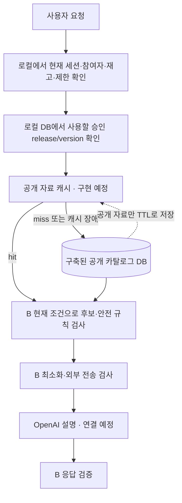

# A 반복 요청 분석 및 캐시·Redis 설계

버전 v1 / 2026-11-25 / 담당 A.
상태: **공개 카탈로그 memory/Redis cache-aside 및 로컬 카운트 구현, 실제 Redis 연결 검증**.
실행/검증 기준은 [Redis 실행 가이드](A_Redis_실행_및_검증.md)를 따른다.
FAQ/RAG·개인화 cache·영속 패턴 분석·자동 cloud 전송은 미구현이다.
설정: config/cache_policy.json. factory가 읽으며 변경 후 앱을 재시작한다.
개인정보 로컬 보관과 공개 식품 DB 사전 구축 원칙은 그대로 유지한다.

## 1. 개념과 KINI 예시

| 개념 | 의미 | 예시 |
|---|---|---|
| 원본 DB | 없어지면 안 되는 사실·기록 | 재고 200g, 식약처 영양값, 실제 섭취 이력 |
| 패턴 분석 | 어떤 종류의 조회가 얼마나 반복되는지 확인 | 공개 레시피 상세 조회가 자주 반복됨 |
| 캐시 | 다시 만들거나 조회할 수 있는 결과의 임시 사본 | 같은 release의 두부 영양정보 재사용 |
| Redis | 빠른 key/value 접근·만료 기능을 제공하는 별도 저장 서비스 | 공개 영양정보를 키로 저장하고 TTL 후 만료 |
| TTL | 캐시를 보관할 시간 | 24시간 뒤 삭제, 다음 요청 때 DB에서 다시 읽음 |
| hit/miss | 캐시에 있음/없음 | hit면 임시 사본, miss면 원본 DB 조회 |
| 무효화 | 원본 변경 후 예전 사본을 쓰지 않게 하는 처리 | release/cache version이 바뀌면 새 키 사용 |

Redis가 스스로 사용자 의도를 이해하거나 음식 선호를 학습하는 것은 아니다.
반복 조회 통계는 캐시 대상을 고르는 데 쓰고, 가족 선호 학습은 로컬 선호 DB와 B 정책이 담당한다.
같은 '저녁 추천' 발화라도 참여자·재고·알레르기·섭취 이력이 달라지면 다른 요청이다.
문장이 비슷하다는 이유로 예전 메뉴를 돌려주지 않는다.

## 2. 먼저 측정하고 캐시 범위를 늘린다

1. 고정된 작업 종류별 호출 수·지연을 로컬에서 집계한다.
2. 공개 카탈로그의 동일 ID/release를 얼마나 반복 조회하는지 로컬 제한 집계로 확인한다.
3. 반복이 많고 읽기 비용이 큰 공개 조회부터 캐시한다.
4. 적용 전후 hit ratio·DB 조회 수·P95 지연·원본 오류 수를 비교한다.
5. 효과가 없으면 TTL/대상을 조정하거나 캐시를 끈다. Redis 도입 자체가 목표는 아니다.

초기 분석 종류: public_food_detail/public_recipe_detail/approved_faq_retrieval.
조회 결과와 hit/miss/error/bypass 및 지연 구간을 집계한다.
request_count와 key별 인기 순위는 로컬에만 둔다. raw text·가족/회원/기기/세션 ID·건강 조건은 수집하지 않는다.
공개 식품 ID의 조회 순서도 사용자 습관과 연결될 수 있어 항목별 접근 이력은 클라우드로 내보내지 않는다.
hash를 붙였다는 이유만으로 개인정보가 비식별화된 것으로 보지 않는다.
고정된 공개 ID 분석도 로컬 보관 7일·최대 1000개 후보라는 제한을 제안하며 수집기/정리 작업은 아직 없다.
Cloud에는 기존 allowlist의 일별 cache_hit/cache_miss 합계만 전송하는 것으로 한정한다.

## 3. 캐시할 것과 제외할 것

| 대상 | 초기 정책 | 이유 |
|---|---|---|
| published release의 식품 영양 상세 | 허용 설계, TTL 24시간 | 같은 원본 ID/버전이면 같은 공개 정보 |
| published release의 레시피 상세 | 허용 설계, TTL 24시간 | 재료·단계·출처의 공개 사본 |
| 승인된 일반 FAQ topic의 RAG 검색 결과 | 조건부 허용, TTL 15분 | corpus/retriever/limit까지 같을 때 공개 근거 재사용 |
| 이름·원문 질문·음성 전사 | 제외 | 개인정보·건강정보가 들어갈 수 있음 |
| 가족·알레르기·영양 목표·선호 profile | 제외 | 개인 DB에서 현재 조건 조회 |
| 냉장고 현재 재고·입출고·식사 이력 | 초기 제외 | 잦은 변경·개인 이력·잘못된 추천 위험 |
| 추천 후보 순위·최종 개인화 메뉴 | 제외 | 현재 조건으로 B가 다시 계산 |
| OpenAI 최종 답변·오류·privacy_blocked | 제외 | 이전 답변이 현재 정책/안전을 보장하지 않음 |
| 로그인/외부 API token·비밀키 | 제외 | 캐시 범위 아님 |

승인 FAQ는 raw query를 hash해서 키로 만드는 것이 아니다.
B가 로컬에서 고정 공개 topic ID로 변환하고, 공개 corpus만 검색할 때 허용한다.
정의되지 않은 topic·원문·민감 조건이 섞이면 cache bypass한다.
demo 데이터와 공식 검증 데이터도 같은 키로 섞지 않는다. 초기 캐시는 published/권리 승인된 데이터로 제한한다.

## 4. 요청 처리 구조 — Cache-aside



공개 자료를 가져오는 과정만 캐시한다. B가 매 요청 현재 개인 조건을 검사하는 흐름을 생략하지 않는다.
원본은 사전 구축한 DB이며 캐시 miss 때 식약처/만개의레시피 API를 직접 호출하지 않는다.
현재 SQLite 공개 사본/remote 조회 provider 연결도 아직 진행 중이므로 이 그림은 통합 목표다.

## 5. 캐시 키 계약

식품/레시피 키 예:

```text
kini:v1:public:{source}:{release_uuid}:cv{cache_version}:food:{external_id}
kini:v1:public:{source}:{release_uuid}:cv{cache_version}:recipe:{external_id}
```

일반 FAQ 검색 키 예:

```text
kini:v1:public:faq:{corpus_release}:rv{retriever_version}:{approved_topic_id}:limit{limit}
```

키에는 이름·가구/회원/기기/세션 ID·건강 조건·원문을 넣지 않는다.
source/release/cache version/schema version/retriever version이 다르면 다른 캐시다.
검색어·필터가 더 필요하면 임의 문자열을 추가하지 말고 승인된 공개 필터 enum 계약을 먼저 정한다.
최신 active pointer 자체는 초기에는 캐시하지 않고 DB에서 확인한다.
release가 없거나 미승인·미배포이면 cache bypass하고 원본 경로의 오류/품질 계약을 따른다.

## 6. TTL·무효화·동시 요청

- food/recipe TTL 제안 86400초, FAQ TTL 900초. 만료 분산을 위해 ±10% jitter를 제안한다.
- publish/rollback이 DB에서 commit된 뒤 새 release/cache_version 키를 사용한다.
- 이전 키는 새 요청에서 참조하지 않고 TTL로 사라지게 한다. 필요 시 A namespace만 제한 삭제한다.
- 다른 앱의 키까지 지우는 FLUSHDB/FLUSHALL은 운영 방법으로 사용하지 않는다.
- DB 쓰기 실패/rollback 때 새 버전 캐시를 만들지 않는다.
- 현재 재고/참여자 변경은 개인 추천 재계산 사유다. 공개 두부 영양값 캐시를 지울 필요는 없다.
- 같은 키가 동시에 만료되면 한 프로세스에서 같은 DB 조회를 합치는 single-flight를 먼저 구현할 예정이다.
- 여러 서버가 생기면 짧은 Redis 분산 잠금과 소유자 확인 해제를 검토한다. 캐시 잠금은 재고 쓰기 잠금과 별개다.
- 잠금/캐시 실패 시 무한 대기하지 않고 원본 DB 조회로 전환한다. DB 오류는 숨기지 않는다.
- 초기에는 negative cache(없는 값 보관)와 stale 결과 제공을 사용하지 않는다.

## 7. 반복 요청 처리와 영속 기록을 구분

| 반복 상황 | 처리 |
|---|---|
| 같은 공개 레시피를 여러 번 읽음 | 캐시 가능 |
| 입고 confirm 응답 유실로 재전송 | SQLite 이벤트 ID/fingerprint 멱등 처리. 캐시로 중복 방지하지 않음 |
| 동일 음성 문장을 다시 말함 | 현재 조건으로 새 요청 해석·검사. 문장 일치로 최종 메뉴 재사용하지 않음 |
| 가족이 반복해서 특정 재료를 거절 | 로컬 preference_evidence/inferred_preferences의 B 정책으로 처리 |
| 여러 사용자가 같은 cache key를 동시에 조회 | 조회 합치기/짧은 잠금. 영속 데이터 정확성은 원본 DB가 보장 |

입출고 이벤트 멱등성을 Redis TTL로 대체하면 재시작/만료 후 중복 차감이 가능하므로
현재의 SQLite UNIQUE(household_id,client_event_id)와 확인 fingerprint를 그대로 유지한다.

## 8. 용량과 비용

Supabase는 공개 DB 원본을 저장하는 공간이고, Redis는 별도 RAM/서비스다.
Redis를 붙인다고 Supabase 500MB가 늘어나거나 원본 DB 저장 비용이 자동으로 줄어들지는 않는다.
Supabase에 별도 중복 cache 테이블을 만들지 않는다. 150MB 냉장고 변화 예약 예산도 캐시로 사용하지 않는다.

초기 계획:

| 항목 | 제안 |
|---|---|
| 1단계 | 실제 서비스 생성 없이 in-memory/fake provider부터 구현·시험 |
| 프로세스 캐시 예산 | 16MB 목표, 최대 1000개, 값당 64KiB 이하. 실제 object overhead도 고려 |
| 2단계 Redis | 별도 필요성 확인 후 maxmemory 약 32MB로 시작하는 안 |
| Redis eviction | allkeys-lfu 제안. 자주 조회되지 않는 키를 우선 제거하는 근사 정책 |
| Redis persistence | 재생성 가능한 캐시만 쓰므로 RDB/AOF 비활성 제안. 원본 저장소로 쓰지 않음 |
| 서버 접근 | 로컬/사설 연결·ACL, 공개 인터넷 노출 금지. 원격 서비스면 TLS 검토 |

LFU 내부 빈도는 캐시 제거를 돕는 것이며 사용자 행동 분석/선호 학습 시스템을 대신하지 않는다.
유료 Redis 계약은 하지 않았다. 로컬 Docker Redis를 선택 실행하고 실제 연결·장애 fallback을 검증했다.
재시작 후 비어 있는 캐시는 정상이며 원본 DB에서 다시 채운다.

## 9. 구현할 내부 인터페이스와 담당

아래 개념은 MemoryCache/RedisCache/DisabledCache, PublicCatalog, PatternStats로 구현했다.
공개 상세 HTTP 및 상태 조회는 실행 가이드를 따른다. FAQ 검색 provider 연결은 예정이다.

```text
CacheProvider.get(public_key) -> cached_value | miss
CacheProvider.set(public_key, approved_public_value, ttl_seconds)
CacheProvider.delete(public_key)
PublicCatalogReader.read(source, release, external_id) -> source_of_truth_value
PatternCounter.record(namespace, public_key, hit_or_miss, latency_bucket) -> local bounded aggregate
```

A: provider/fake/TTL/크기 제한/키 생성·무효화·로컬 지표·장애 fallback.
B: 승인된 공개 FAQ topic·검색 버전, 현재 개인 조건 검증, AI 오류 시 추천 중단 유지.
C: 최신 재고/품질 상태 표시. cache hit를 '현재 식사에 안전함'으로 표시하지 않는다.
공개 조회 endpoint를 A API에 추가했으며 기존 추천 응답·B/C 파일은 변경하지 않았다.

구현 순서:

1. 공개 조회 provider와 memory/Redis adapter는 연결했다. 공식 식품 사전 적재는 키 설정 후 진행한다.
2. monotonic clock 기반 memory TTL·크기 제한·직렬화 및 원본 fallback을 구현했다.
3. 프로세스 로컬 공개 조회 카운트를 구현했다. 실제 서비스 트래픽의 효과 측정은 후속이다.
4. release 변경·오류·개인 필드 오염·동시 miss 합치기를 시험했다.
5. Redis client는 dependency에 포함하지만 실행 서버는 선택이다. 기본 memory와 disabled 모드를 지원한다.

## 10. 완료 기준과 검증 계획

- 같은 공개 ID/release의 반복 조회는 첫 DB 조회 이후 hit가 되어 DB 호출 수가 줄어든다.
- TTL 만료·release 변경·rollback은 새 원본 조회로 이어진다.
- 캐시 장애는 원본 조회로 전환하며 원본 장애는 정상 응답으로 위장하지 않는다.
- 가족/건강/원문/토큰이 키·값·클라우드 지표에 들어가기 전에 거절된다.
- 같은 공개 근거를 사용해도 새 알레르기/참여자/재고 조건은 B가 다시 검사한다.
- 최대 entries/value/memory를 넘으면 보관하지 않거나 제거하고 원본 요청은 처리한다.
- 같은 key의 동시 miss는 조회가 폭증하지 않으며 실패 잠금이 영구적으로 남지 않는다.
- 패턴 집계는 로컬 보관/후보 수 제한을 지키고 cloud에는 일별 hit/miss 합계만 남는다.
- 구현/실제 연결 시험 결과는 Redis 실행 가이드와 최신 개발 현황에 기록한다. 설계의 모든 후속 항목이 완료된 것은 아니다.

## 공식 참고

- Cache-aside: https://redis.io/docs/latest/develop/use-cases/cache-aside/
- TTL: https://redis.io/docs/latest/develop/using-commands/keyspace/
- Memory eviction: https://redis.io/docs/latest/reference/eviction/
