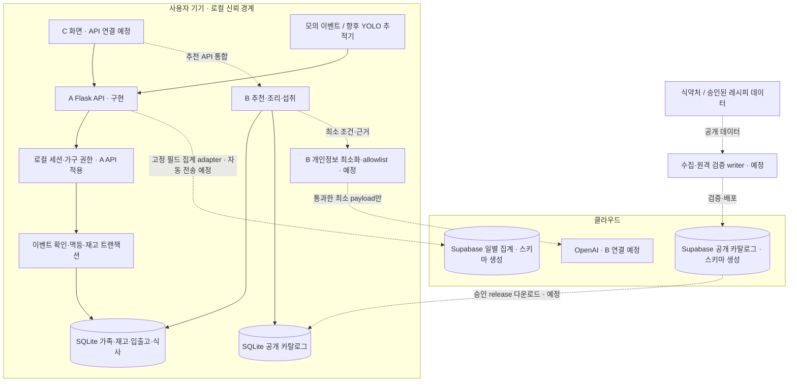
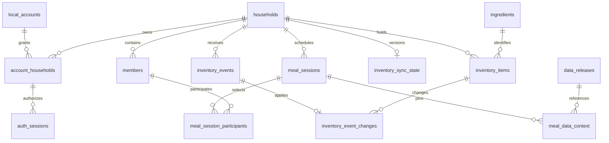
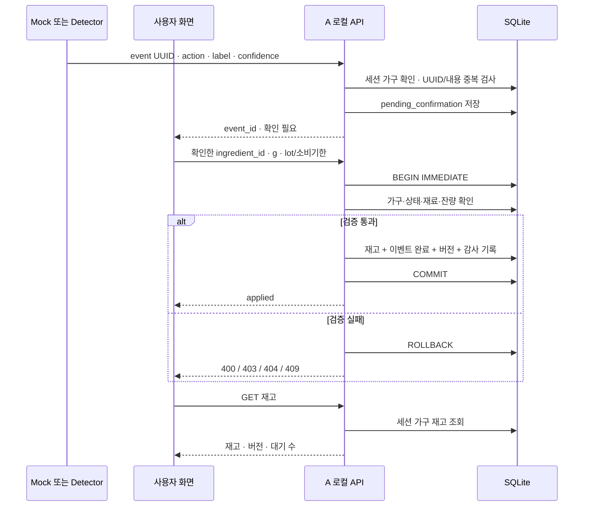
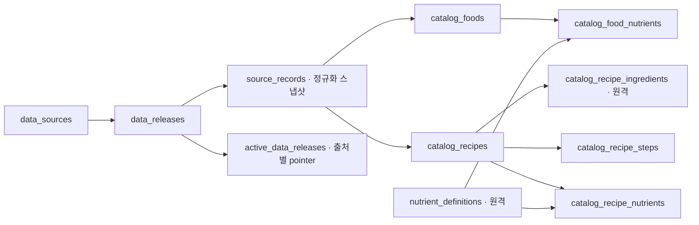

# A 데이터 플랫폼 아키텍처

버전 v1 / 2026-11-25 / 담당 A.
연결: [API](A_API_명세서.md), [기능](A_기능_명세서.md), [개발 현황](A_개발현황.md).
그림의 '예정'은 구현되지 않은 연결이다. 첨부 워크플로우의 인식/LLM 레인은 팀원 A/B/C 소유권과 구분한다.

## 1. 핵심 결정

1. 개인 데이터와 실제 재고 이력은 SQLite 로컬 전용이다.
2. 공개 영양/레시피 카탈로그와 비식별 운영 집계는 기존 KINI Supabase 프로젝트에 둔다.
3. 공개 카탈로그의 로컬 사본을 만들어 개인 조건과 로컬에서 결합하는 것이 목표다. 자동 다운로드는 아직 없다.
4. 인식 결과는 확인 대기이고, 명시적 재료/중량 확인 후만 재고에 반영한다.
5. ThinQ 인증·실기기 연결은 이번 데모 범위에서 제외한다. 가상 기기 provider도 현재 예정이다.
6. A는 B의 추천/알레르기/AI 정책과 C의 화면 코드를 직접 변경하지 않는다.

## 2. 구성도

현재 B의 AI 호출은 기존 로컬 Ollama 코드다. 이 그림의 OpenAI/보안 게이트 연결을
완료된 것으로 해석하지 않는다. 개인 DB에서 Supabase로 복제하는 연결은 없다.

## 3. 저장소별 책임

| 저장소 | 허용 데이터 | 제외 데이터 | 현재 |
|---|---|---|---|
| SQLite 개인 영역 | 계정/세션·가족·알레르기·실재고·입출고·섭취·개인화 | 외부 자동 복제 | 스키마/repository/일부 인증 API 구현 |
| SQLite 공개 사본 | 승인 식품/레시피 release·검토 매핑 | 키/외부 인증 URL | 로컬 import·publish·rollback 구현 |
| Supabase 공개 카탈로그 | 공개/승인 정규화 식품·영양·레시피·출처·release | 개인 재고 이력·가족/기기 ID·개인 질환·원문 | 11개 테이블 생성, 식품 미적재 |
| Supabase 지표 | 날짜·고정 지표 코드·집계 건수·합계 | 식사/이벤트 원문·식재료별 가구 이력 | 1개 테이블/adapter, 자동 전송 없음 |
| Redis | 향후 공개 카탈로그·비식별 검색 캐시 | 개인 조건·세션·토큰 | 미연결 |

가구의 '두부를 언제 넣고 뺐는지'는 공개 식품 정보가 아니다. 첨부 그림의 재료 출입 기록
클라우드 업로드는 로컬 저장으로 조정한다. 원본 이미지·음성은 A 이벤트 API가 받지 않는다.

## 4. 로컬 ERD와 세션 조인

로그인 세션은 account+active household+role을 검증한다. 식사 세션은 그 가구의 이번 참여자 집합이다.
인증 토큰은 무작위 32byte 기반이며 SQLite에는 SHA-256 해시만 저장한다.
비밀번호는 Werkzeug scrypt 해시다. 세션 만료/폐기와 계정 활성·가구 권한을 매 조회 시 확인한다.
로그인 HTTP·CSRF·시도 제한·기존 B endpoint 전체의 인증은 아직 구현되지 않았다.

검증된 household_id로 meal_session→participants→members를 조인한다. ID만으로 다른 가구의
구성원·식사·재고를 읽지 않는다. ingredient_id는 외부 food code와 별개의 로컬 재료 키다.
catalog_ingredient_links/catalog_recipe_links는 검토된 매핑용이며 자동 이름 매칭을 의미하지 않는다.

## 5. 인식 이벤트 반영 시퀀스

트랜잭션은 이벤트 함수가 소유한다. 미커밋 쓰기가 있는 connection에서 중첩 호출하지 않는다.
두 출고가 경쟁하면 쓰기 잠금 후 최신 수량을 검사한다. 반복 confirm은 같은 fingerprint일 때만 재사용한다.
적용된 이벤트의 취소는 과거 기록 삭제가 아니라 새 보정 이벤트로 남긴다.
조회는 현재 multi-query read여서 동시 변경 시 완전한 시점 일관성은 후속 보강 대상이다.

## 6. 공개 카탈로그 구조와 release

식별 범위는 source+external_id, 버전 포함 키는 release_id+external_id다.
식품 영양 basis는 g/ml, 레시피 영양은 g/ml/serving이다. 누락 nutrient는 행이 없거나 null이며 0과 다르다.

로컬 release 상태: staging→validated 또는 quarantined→(검증 통과 release만) published.
격리 release는 수정 재검증 대신 새 stage로 재수집하는 것이 현재 repository 계약이다.
publish에는 출처 이용 조건 승인이 필요하다. rollback은 같은 source의 published pointer를 복구한다.
로컬 cache_version은 publish/rollback마다 증가하지만 아직 Redis TTL 구현은 없다.

원격 DB는 food/recipe kind와 FK, 영양값·기준량, 같은 source의 published pointer를 제약한다.
원격 writer의 권리 승인·검증·pointer 변경 트랜잭션과 cache_version 증가는 아직 미구현이다.
로컬·원격 release/report/recipe field 구조 차이를 자동으로 복제하면 안 된다.

### 원격→로컬 동기화 목표(예정)

1. 서버가 source의 승인된 published manifest와 release를 조회한다.
2. 페이지·row count·checksum·단위·권리 상태를 검증하면서 임시 영역으로 다운로드한다.
3. 원격 release UUID 보존/매핑을 명시하고 부분 다운로드가 live pointer를 바꾸지 못하게 한다.
4. 로컬에 완전한 release를 적재하고 검토된 재료·레시피 매핑을 만든다.
5. 원자적으로 pointer/cache version을 전환한다. 실패하면 이전 release를 유지한다.
6. 식사 당시 meal_data_context·nutrition_intakes는 새 카탈로그로 재계산/덮어쓰기하지 않는다.

## 7. 캐시·집계·장애 경계

- 제안 캐시 키: `catalog:{source}:{release_id}:{cache_version}:{kind}:{external_id}`. TTL 제안 24시간.
- Redis miss/장애는 로컬 공개 카탈로그 조회로 처리할 예정. 개인 조건 검사는 항상 B에서 실행한다.
- 지표는 일별 절대 합계 upsert, 단일 writer. Supabase 지표 장애로 SQLite 재고 변경을 롤백하지 않는다.
- remote import/sync 실패는 기존 공개 release를 유지한다. 무검증 응답을 현재 데이터로 표시하지 않는다.
- OpenAI 실패 시 B/C는 api_error로 추천을 중단한다. A의 카탈로그/캐시 fallback이 대체 추천을 생성하는 것은 아니다.
- ThinQ/YOLO 연동 실패를 단순 재고 0으로 변환하지 않는다. 향후 가상 기기/연결 상태 계약에서 다룬다.

## 8. 배포와 보안

로컬 API를 사용하는 데모 서버 1개와 Supabase 프로젝트 1개 구조다. 여러 Flask 서버가 서로 다른
SQLite 파일을 공유 데이터처럼 사용하는 구조는 지원하지 않는다. 카메라/브라우저는 DB에 직접 쓰지 않는다.
현재 앱 직접 실행의 APP_HOST 기본은 0.0.0.0이며 local_runtime.py는 미지정 시 127.0.0.1로 제한한다.
데모 실행에는 APP_HOST=127.0.0.1을 명시하고, 휴대폰 접근은 인증·네트워크 설정을 확정한 뒤 진행한다.

Supabase 신규 카탈로그 11개 테이블은 RLS+service_role policy, 일반 사용자 grant 제거 상태다.
운영 지표는 RLS+일반 사용자 접근 차단이며 backend만 사용한다.
server secret은 .env에만 두고 저장소·화면·브라우저에 넣지 않는다. 프로젝트 ref/URL은 비밀키가 아니다.
SQLite·백업 파일은 Git 제외다. SQLite 파일 암호화·보존/삭제·복구 운영은 아직 없다.
실제 개인정보 입력은 기존 전체 API 권한과 암호화/로그 정책 완료 후 진행한다.

## 9. 관련 구현과 문서 유지

| 영역 | 파일 |
|---|---|
| bootstrap/migration | recommendation_repository.py, data_platform.py, data_platform_schema.sql |
| 로컬 권한 | local_identity.py |
| 인식→재고 | inventory_events.py, data_status_api.py |
| 로컬 카탈로그 | catalog_repository.py, data_import/mfds_recipe.py |
| 원격 DB | db/supabase_schema.sql, supabase_food_catalog.sql, supabase_food_catalog_indexes.sql |
| 운영 도구 | scripts/init_database.py, scripts/import_catalog.py |
| 경계 검증 | tests/test_data_platform.py, tests/test_inventory_events.py |

API 변경 시 API 명세서/공통 계약/fixture를 함께 갱신하고 B/C에게 연결 변경을 전달한다.
이 문서는 [기존 DB 상세 설계](DB_아키텍처_및_연동_설계.md)와 [워크플로우 반영 설계](워크플로우_반영_설계.md)의 A 구현 기준 요약이다.
