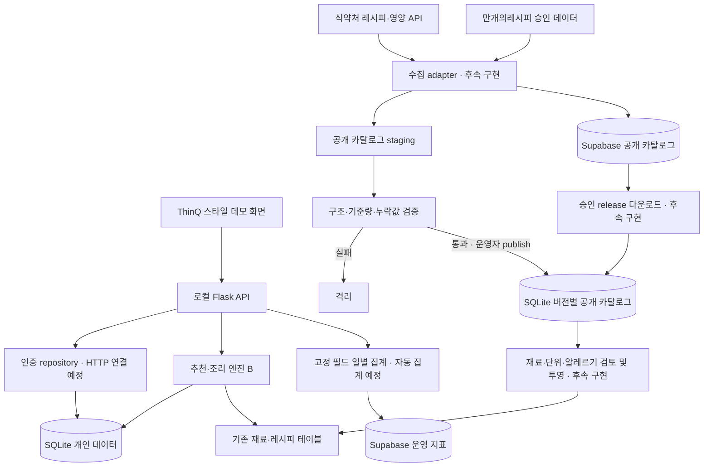
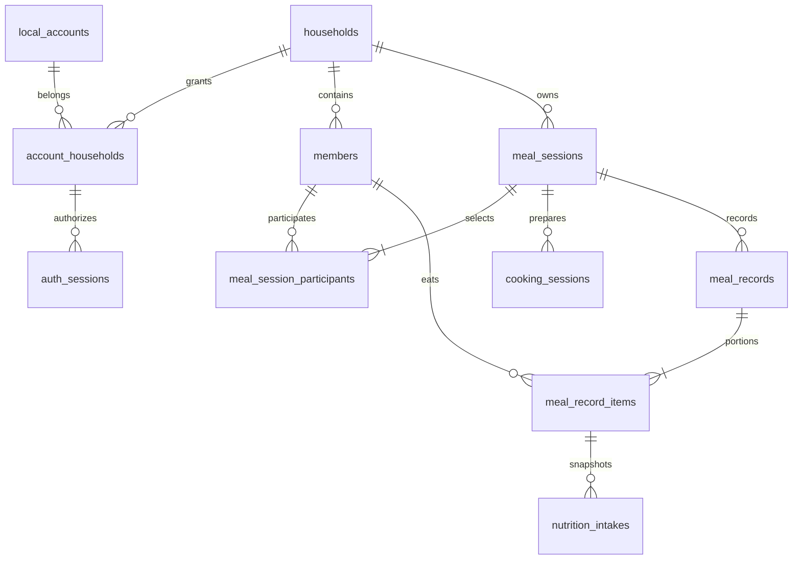

# KINI DB 아키텍처 및 연동 설계

작성: 2026-11-25 / 역할 A / 기준 main 5d80dc2 / 공유 브랜치 codex/a-data-platform-specs.

## 1. 결정과 실제 구현 범위

2026-11-25 사용자 추가 확정: **기존 KINI Supabase 프로젝트에 영양성분·레시피 테이블 추가**.
Supabase에는 공개/승인 식품 카탈로그와 비식별 운영 집계를 저장한다.
SQLite에는 가족·알레르기·재고·입출고 이력·식사·대화·로그인 세션과 공개 카탈로그의 로컬 사본을 둔다.
개인정보와 공개 사본은 논리적으로 분리된 테이블이며, SQLite 안에서 외래키와 트랜잭션으로 조인한다.
별도 파일의 ATTACH나 원격 DB 조인을 사용하지 않는다. 가족·알레르기·식사·대화·기기 ID는 업로드하지 않는다.
공개 카탈로그의 Supabase→SQLite 자동 동기화는 후속 구현이다. 현재 양쪽 스키마를 생성한 상태다.
Redis는 아직 연결하지 않는다. 데이터 release와 cache version으로 향후 연결 계약만 정한다.

이번에 구현: 빈 로컬 DB 생성, 추가 스키마, 인증 repository, 식사 참여자 권한 확인 repository,
공개 카탈로그 staging/검증/격리/명시적 publish/rollback, 비식별 지표 adapter, 데이터 상태 API,
실제 Supabase 프로젝트와 운영 지표·공개 카탈로그 테이블,
로컬 인식 이벤트 수신·확인·거절·멱등 재고 반영 및 인증이 적용된 A 전용 API.

아직 미구현: HTTP 로그인·가입·로그아웃·CSRF·로그인 시도 제한, 기존 B API 전체에 인증 적용,
암호화/보존/삭제/백업 운영, 외부 API 일괄 수집, 카탈로그를 추천용 테이블에 투영하는 승인 절차,
기존 JSON 재고의 SQLite 통일, Redis 실제 연결, 운영 지표 자동 집계·업로드 스케줄.
**실제 개인정보를 입력할 수 있는 완성된 서비스로 간주하지 않는다.**

## 2. 기존 코드 분석

`recommendation_repository.connect()`는 KINI_DB_PATH 또는 app/data/kini.sqlite3를 열고,
sqlite3.Row와 foreign_keys=ON, timeout=10을 설정한다.
`initialize()`는 CREATE TABLE IF NOT EXISTS와 PRAGMA table_info 기반 ALTER TABLE을 실행한다.
기존에는 households가 비어 있으면 데모 가족·알레르기·재고·예시 영양·레시피가 자동 입력됐다.
새 `seed_demo=False` 또는 KINI_SEED_DEMO=0은 이를 차단한다. 빈 private DB는 dataset_mode로 표시되어 재실행해도 자동 seed하지 않는다.
이미 데모가 들어 있는 DB는 이 설정으로 삭제하거나 변환하지 않는다. 새로운 파일을 만들어야 한다.

기존 테이블:

| 묶음 | 테이블 | 의미 |
|---|---|---|
| 가족 | households, members | 가구와 구성원 |
| 개인 조건 | member_allergies, member_health_constraints, member_nutrition_targets, member_preferences | 구성원별 조건 |
| 식재료 | ingredients, ingredient_aliases, ingredient_nutrition, ingredient_allergen_tags, unit_conversions 등 | 추천 계산용 재료 마스터 |
| 재고 | inventory_items | 가구별 재고, 중량·기한·확인 상태 |
| 레시피 | recipes, recipe_ingredients | 추천 엔진이 읽는 조리 시간·인분·재료 중량 |
| 식사 | meal_sessions, meal_session_participants | 한 끼와 다대다 참여자 |
| 추천 | recommendation_requests, recommendation_candidates | 입력·결과 JSON 및 후보 |
| 조리 | cooking_sessions | 선택 레시피·변경한 재료 JSON·완료 상태 |
| 섭취 | meal_records, meal_record_items, nutrition_intakes | 식사 결과와 개인별 당시 영양 스냅샷 |
| 개인화 | recommendation_feedback, preference_evidence, inferred_preferences, household_behavior_summary | 피드백·선호 추론 |
| 대화 | conversation_sessions, conversation_messages | 식사에 연결할 수 있는 대화 세션 |

현재 API는 요청 household_id와 정수 ID를 사용한다. 가구 일치 검사는 일부 있지만 인증은 아니다.
기존 식사 생성 handler는 새 인증 repository를 아직 호출하지 않는다.
기존 cooking.create는 추천의 참여자와 식사 참여자 집합 일치를 검사한다.
기존 cooking.complete는 개인별 servings를 곱한 영양 수치를 nutrition_intakes에 기록하므로
나중에 식품 영양 정보가 갱신되어도 과거 섭취 값을 다시 계산할 필요가 없다.
재고 차감은 이 함수에서 구현되어 있지 않다.

기존 /api/inventory는 inventory.json을 읽고, 추천은 SQLite inventory_items를 읽는다.
food_safety.py의 식약처 조회는 외부 API 조회와 레시피 메모리 캐시일 뿐 영구 import가 아니다.
첨부 시작 문서의 data_import/ 및 release pointer 구현은 조사한 main에 없었다.
원문 대화 저장을 지원하는 스키마가 있지만 현재 메시지 handler는 [원문 미보관]만 저장한다.
DB를 로컬에 둔 것만으로 암호화되거나 인증되는 것은 아니다.

## 3. 전체 연동



외부 식품 API는 식사 요청 때마다 호출하지 않는다. 데이터 담당자가 주기적으로 수집·검증하고 배포한다.
import 장애와 Supabase 장애가 로컬 가족 데이터 저장 트랜잭션을 롤백시키지 않도록 경계를 나눈다.
외부 API 검색어에도 사용자 이름·원문 발화·건강 정보를 넣지 않는다.

## 4. 로그인 세션과 식사 세션

| 식별자 | 수명 | 저장 내용 |
|---|---|---|
| local_accounts.id | 계정 수명 | 로컬 로그인 주체. 가족 구성원 ID와 별개 |
| auth_sessions.token_hash | 기본 1시간, 최대 24시간 | 계정·활성 가구·만료·폐기. 원본 토큰은 DB에 저장하지 않음 |
| meal_sessions.id | 식사 기록 수명 | 한 끼의 가구·식사 종류·참여자 |
| cooking_sessions.id | 조리 및 기록 수명 | 추천 요청·식사·선택 레시피·변경안 |
| conversation_sessions.id | 대화 업무 수명 | 목적과 선택적인 meal_session_id |

한 계정은 account_households를 통해 여러 가구의 owner/editor/viewer가 될 수 있다.
가족 구성원은 로그인 계정 없이 식사에 참여할 수 있다. 아이나 할머니에게 별도 로그인 계정을 강제하지 않는다.
로그인 시 서버는 소속 가구를 확인하고 256비트 무작위 토큰을 발급한다.
비밀번호는 Werkzeug scrypt 해시, 원본 세션 토큰은 SHA-256 해시만 저장한다.
SHA-256은 비밀번호 저장용이 아니라 충분히 무작위인 토큰 조회용이다.
로그아웃은 revoked_at을 기록한다. 계정 비활성화·가구 권한 변경은 매 authorize 호출에 반영된다.

향후 HTTP 계약: 토큰은 HttpOnly, SameSite 쿠키에 넣고 HTTPS에서 Secure를 사용한다.
인증이 필요한 모든 endpoint는 서버에서 토큰을 해석한 가구를 기준으로 조회한다.
클라이언트가 household_id를 보내더라도 권한의 근거로 믿지 않는다.
쿠키 인증 변경 요청에는 CSRF 방어를 적용하고 로그인에는 시도 제한을 둔다.
브라우저 쿠키에 이름·알레르기·원문 대화를 넣지 않는다.

## 5. 조인과 트랜잭션



예: 로그인한 보호자가 엄마·아이를 선택하면, auth_sessions에서 가구를 알아낸다.
선택한 두 member_id가 모두 그 가구 소속인지 확인한 뒤 meal_sessions 1행과
meal_session_participants 2행을 **같은 트랜잭션**에서 만든다.
새 create_meal_for_session()은 활성 release를 meal_data_context에 함께 고정한다.
가구가 다른 참여자가 하나라도 있으면 아무 식사 세션도 저장하지 않는다.

권한 확인 후 참여자를 읽는 SQL은 다음과 같다. ID만으로 전체 가구를 조회하면 안 된다.

```sql
SELECT m.id,m.name,m.age
FROM meal_sessions s
JOIN meal_session_participants p ON p.session_id=s.id
JOIN members m ON m.id=p.member_id AND m.household_id=s.household_id
WHERE s.id=:meal_session_id AND s.household_id=:authorized_household_id;
```

알레르기·목표를 여러 일대다 테이블에 한꺼번에 조인하면 행 수가 곱해질 수 있다.
참여자 집합을 먼저 확정하고 각 조건을 별도로 조회하거나 구성원별 집계 후 결합한다.
기존 members()는 별도 조회 방식이다. nutrition_intakes 집계는 record_item_id로 조인한다.
식품명 문자열이나 외부 식품코드를 member_id와 연결하지 않는다.

조리 완료 시 개인별 섭취량·영양 스냅샷·완료 처리를 한 트랜잭션에 묶는다.
향후 재고 차감도 동일 트랜잭션과 완료 재시도 방지 장치를 갖춰야 한다. 이는 B와 계약 후 추가한다.
새 인증 repository를 거치지 않는 기존 API는 현재 이 권한 보장을 제공하지 않는다.

## 6. 식품 카탈로그와 영양 기준

data_sources → data_releases → source_records → catalog_foods/catalog_recipes.
food의 세부 수치는 catalog_food_nutrients, 레시피 순서는 catalog_recipe_steps에 저장한다.
source_records는 **정규화된 입력 스냅샷**과 SHA-256을 저장한다. HTTP 원본 전체를 보관하는 raw landing 저장소는 아니다.
source_revision에는 배포 날짜나 원본 파일 버전을 기록한다. 인증키가 포함된 요청 URL은 저장하지 않는다.

공식 식품코드의 식별 범위는 source_code + external_id이며, 버전까지 포함하면 release_id + external_id다.
닭고기 생것/삶은 것, 원재료/상용제품, 100g/100mL/1인분은 다른 의미다.
영양값은 basis_amount와 basis_unit을 함께 저장한다. g와 mL를 밀도 없이 변환하지 않는다.
값 누락은 NULL 또는 nutrient 행 부재로 유지한다. 0으로 채우지 않는다.
단백질·탄수화물·지방·당류는 g, 나트륨은 mg, 열량은 kcal라는 nutrient 코드로 단위를 고정한다.

레시피 수집 시 재료 문자열·조리 단계는 저장할 수 있지만,
문자열을 재료별 g으로 나누는 작업은 별도 검토가 필요하다.
외부 레시피의 영양은 1인분 기준인지 확인 전 기존 ingredient_nutrition에 복사하지 않는다.
레시피별 공식 영양은 catalog_recipe_nutrients에 기준량·단위와 함께 저장한다.
COOKRCP01 normalizer는 INFO_* 영양값을 1인분 기준으로 보존하고,
전체 레시피 servings나 개별 재료 g은 추정하지 않는다.
`scripts/import_catalog.py stage --format cookrcp01`로 저장해 둔 공식 응답 JSON을 정규화할 수 있다.
식품영양성분 API의 상세 응답 fixture를 확보한 뒤 food의 실제 필드 mapping을 확정한다.

catalog_ingredient_links와 catalog_recipe_links는 사람이 검토한 매핑을 위한 테이블이다.
현재 자동 매핑/투영은 없다. catalog_food_nutrients는 공개 데이터 저장이 완료돼도
기존 추천 엔진이 자동 사용하지 않는다. B의 데이터 품질·알레르기 규칙을 우회하지 않는다.

## 7. Release와 캐시

1. stage: 출처·revision을 지정해 새 UUID release와 정규화 스냅샷 저장. 중복 ID는 전체 stage 롤백.
2. validate: 이름·기준량·단위·음수/비유한 영양값·조리 단계 검사. 하나라도 실패하면 release 전체 격리.
3. publish: validated 상태와 이용 조건 승인 모두 필요. 정규화 테이블 입력과 pointer 변경을 같은 트랜잭션에 수행.
4. rollback: 같은 source의 이전 published release로 pointer 복구. 기존 데이터 삭제 없음.
5. publish와 rollback마다 해당 source의 cache_version 증가.

여러 출처를 각각 publish한다. 서로 다른 출처를 하나의 원자적 release 묶음으로 배포하는 기능은 아직 없다.
recipe/food 스키마 검증은 추천 안전 검증이 아니다. 조리 인분·중량·알레르기 검토는 별도로 필요하다.

향후 캐시 키 계약:
`catalog:{source_code}:{release_id}:{cache_version}:{kind}:{external_id}`.
TTL 기본안 24시간. release 변경 시 새 키를 사용하고 오래된 키는 TTL로 정리한다.
식사 세션이 고정한 과거 release를 읽을 때는 현재 pointer로 치환하지 않는다.
캐시 miss는 SQLite를 읽으며, 캐시 때문에 현재의 개인 제한 검사를 생략하지 않는다.
개인 추천 결과·가구/회원 ID·알레르기·원문·토큰은 Redis에 저장하지 않는다.

## 8. Supabase

프로젝트: KINI / 서울 ap-northeast-2 / ref zyjrwychceuxxfdproev.
생성 시 도구 견적: 월 $0. 실제 사용량과 향후 요금 변경은 별도다.
스키마: db/supabase_schema.sql와 db/supabase_food_catalog.sql.
원격 migration: kini_operational_metrics_v1, kini_food_catalog_v1.

운영 지표 테이블 kini_daily_metrics:
metric_date(date) + metric_code(고정 enum) 복합 PK,
sample_count(bigint), total_value(double precision).
지연은 ms 합계와 건수, 성공·오류·캐시는 건수로 해석한다. 사용자 단위 분석을 하지 않는다.
날짜 버킷은 Asia/Seoul 기준으로 upstream 집계자가 생성한다.
일별 절대 합계를 upsert하므로 같은 snapshot 재시도는 멱등하다.
동일 날짜/metric에 여러 독립 writer가 쓰면 덮어쓸 수 있으므로 **단일 집계 writer**가 필요하다.
현재 자동 집계와 백그라운드 업로드는 비활성이다.

운영 지표에는 고정 필드 외 JSON·이름·가구/회원/기기/세션 ID·건강정보·자유 텍스트 컬럼이 없다.
RLS 활성화, anon/authenticated 권한 제거, service_role만 SELECT/INSERT/UPDATE 허용.
RLS policy 없음은 서버만 사용하는 의도적인 deny-by-default 구성이다.
service_role/secret key는 로컬 서버 .env에만 두며, 저장소나 브라우저에 넣지 않는다.
이번에 키를 조회·출력·저장하지 않았다. 따라서 Flask→Supabase REST 실제 업로드는 아직 연결하지 않았다.
운영 지표 adapter의 자동 전송도 없다. Supabase SQL 구조·권한은 연결 도구로 직접 검증한다.

공개 카탈로그 11개 테이블:
data_sources, nutrient_definitions, data_releases, source_records,
catalog_foods, catalog_food_nutrients, catalog_recipes, catalog_recipe_steps,
catalog_recipe_ingredients, catalog_recipe_nutrients, active_data_releases.
출처 3개와 영양 코드 6개만 초기 등록했다. 실제 식품·레시피·release 데이터는 아직 없다.
모든 신규 테이블은 RLS와 service_role 전용 policy를 적용하고 일반 사용자 접근은 차단했다.
source_records.payload_json은 공개/승인 데이터의 정규화 스냅샷 전용이며 개인정보·키를 넣지 않는다.
식품/레시피 kind 혼동은 FK로 차단하고 active pointer는 같은 source의 published release만 참조한다.
원격 release publish·rollback 트랜잭션과 cache_version 증가는 향후 ingest writer가 구현해야 한다.
이벤트 재고 API는 [워크플로우 반영 설계](워크플로우_반영_설계.md)를 따른다.

## 9. 실행과 확인

```powershell
.\.venv\Scripts\python.exe scripts/init_database.py
# 앱 기본 경로 app/data/kini.sqlite3, 개인정보/가족/재고를 넣지 않은 빈 private DB
# 데모를 원하면 별도 파일:
.\.venv\Scripts\python.exe scripts/init_database.py --path app/data/kini-demo.sqlite3 --demo

# 정규화 JSON을 먼저 staging. 실제 API 대량 수집 스크립트는 후속 작업이다.
.\.venv\Scripts\python.exe scripts/import_catalog.py --db app/data/kini.sqlite3 stage --source mfds_nutrition --revision 2026-11-25 --input public-foods.json
.\.venv\Scripts\python.exe scripts/import_catalog.py --db app/data/kini.sqlite3 validate --release RELEASE_UUID
# 이용 조건 검토 후 data_sources.rights_status를 승인한 운영자가 publish 실행
.\.venv\Scripts\python.exe scripts/import_catalog.py --db app/data/kini.sqlite3 publish --release RELEASE_UUID
```

정규화 food 입력 예시(예시 수치이며 실제 데이터가 아님):

```json
[{"kind":"food","external_id":"example-1","name":"시연 두부","basis_amount":100,"basis_unit":"g","nutrients":{"energy_kcal":76,"protein_g":8,"sodium_mg":null}}]
```

정규화 recipe 입력 예시:

```json
[{"kind":"recipe","external_id":"example-r1","name":"시연 두부찜","servings":null,"cook_time_minutes":null,"ingredients_text":"두부 100g","steps":["두부를 찐다."]}]
```

개인 DB 파일·백업은 Git에 추가하지 않는다. 로컬 SQLite 자체에는 암호화가 적용되지 않았다.
실제 개인정보 사용 전에 인증을 모든 B API와 연결하고 OS 파일 접근 제한, 디스크/DB 암호화 선택,
백업·삭제·내보내기·동의·보존 정책을 확정한다. 현 단계에는 가상 데이터만 사용한다.

## 10. 담당별 다음 연결

- A: 공식 응답 fixture, batch 수집·재시도·호출 제한, source 권리 확인 기록, 카탈로그 투영·단위 매핑,
  DB 삭제/백업·암호화, 인증 endpoint와 공통 권한 검사 구현.
- B: 기존 handler에서 인증 가구를 사용하고 create_meal_for_session 호출, 조리/기록/대화/추천
  모든 객체에 가구 소유권 검사. 세션 release를 추천 조회에 전달하는 계약.
- C: 로그인·가구 선택 UX, 쿠키 기반 API 호출, /api/data/status 표시. 개인정보를 프론트 캐시·로그에 남기지 않음.

## 공식 근거

- 식약처 COOKRCP01: https://www.foodsafetykorea.go.kr/api/newDatasetDetail.do?svc_no=COOKRCP01
- 식약처 영양 Open API 안내: https://various.foodsafetykorea.go.kr/nutrient/industry/openApi/info.do
- 영양 API 상세: https://www.data.go.kr/data/15127578/openapi.do
- 만개의레시피 제휴 공급 안내: https://www.10000recipe.com/company/intro.html
  공개 API 명세와 키 발급 절차는 이번 조사에서 확인하지 못했다. 승인된 파일/제휴 공급을 전제로 한다.
- Supabase RLS: https://supabase.com/docs/guides/database/postgres/row-level-security
- Supabase 변경 이력 확인: https://supabase.com/changelog.md
