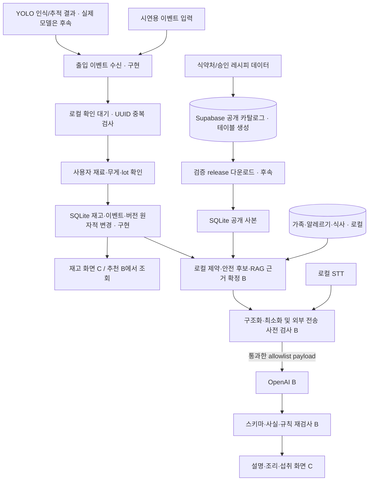

# 첨부 워크플로우 반영 설계

2026-11-25 / A 담당. 기준: 사용자가 첨부한 'KINI AI 냉장고 영양 관리 · 개발 워크플로우'.
그림의 LANE A/B는 인식·LLM 기술 흐름이며, 기존 팀원 역할 A/B/C와 동일하다고 가정하지 않는다.

## 변경한 데이터 경계

사용자가 기존 KINI Supabase에 영양성분·레시피 테이블 추가를 확정했다.
Supabase는 공개 식품/레시피 카탈로그와 비식별 운영 집계를 저장한다.
개인의 가족 프로필·알레르기·건강 조건·재고·입출고 시각·섭취·대화·로그인 토큰은 SQLite에 저장한다.
재료 이름 자체가 공개 정보여도 가구·시각과 연결한 입출고 이력은 생활정보가 될 수 있다.
따라서 그림의 '재료 출입 기록 → Supabase'는 그대로 구현하지 않고 로컬 이벤트 저장으로 바꾼다.
개인 재고를 추천에 사용할 때는 Supabase로 보내지 않고 로컬에서 결합한다.
향후 필요한 인식 운영 지표는 식재료 목록이나 가구 ID가 없는 일별 집계로 별도 검토한다.

## 목표 흐름과 구현 상태

## A가 이번에 구현한 로직

1. Supabase 식품 카탈로그 11개 테이블 생성. 출처 3개·영양 단위 코드 6개 등록.
2. SQLite inventory_events, inventory_sync_state, inventory_event_changes 추가. 기존 데이터 삭제 없는 migration v2.
3. 인식 이벤트 수신 시 UUID+가구 단위 멱등 검사. 원본 이미지·음성·개인정보 클라우드 전송 없음.
4. confidence와 무관하게 pending_confirmation으로 저장. 인식만으로 무게·소비기한·안전 판정을 만들지 않음.
5. 확인 시 로그인 세션 가구와 재료/재고 소속 검사. stock_in은 소비기한별 새 lot, stock_out은 지정 lot 차감.
6. 음수 재고 방지. SQLite BEGIN IMMEDIATE로 동시 확인 직렬화.
7. 재고 갱신·이벤트 완료·버전 증가·확인 계정과 변경 전후 수량의 감사 기록을 한 트랜잭션으로 처리. 동일 재시도는 중복 차감/추가 없음.
8. A 전용 이벤트/조회 API에 로컬 세션 인증 적용. 기존 B handler의 인증 적용 여부는 별개다.
9. 재고 변경 결과가 B가 읽는 inventory_items에 저장됨. 기존 JSON 재고 화면은 C의 새 API 연결이 필요함.

## 첨부 그림에서 수정하거나 추가할 사항

| 항목 | 필요한 수정 |
|---|---|
| 정확도 95% | confidence 0.95, 분류 정확도, 검출 성능을 구분. 어떤 평가 지표·클래스·검증 데이터에서 합격인지 팀이 확정해야 함 |
| 재료 넣기/꺼내기 | 객체 검출 외에 추적·방향/영역 판정·시간 창·가림·재등장 처리 필요. 프레임별 검출 수를 재고로 바로 더하지 않음 |
| 수량·무게 | 검출 박스로 g·남은 포장량을 추정하지 않음. 초기 데모는 확인 입력, 향후 저울·라벨 등 근거 추가 |
| 식품 식별 | 두부류 검출만으로 제품 원재료·알레르겐·소비기한을 확정하지 않음. 재료 표준화와 라벨 확인 별도 |
| 클라우드 재료 조회 | 가족의 실제 재고는 로컬에서 조회. Supabase는 공개 카탈로그를 공급 |
| Ollama 보안 게이트 | 모델 판단만으로 허용하지 않고 고정 필드 allowlist·자유 텍스트 차단·실패 시 차단을 조합. B 담당 |
| OpenAI 후 데이터 연결 | 근거·규칙 후보를 먼저 확정하고 외부 전송 직전에 다시 최소화. 도구 결과나 RAG도 개인정보 검사를 우회하지 않음 |
| 외부 AI 실패 | 기존 합의대로 api_error. 규칙 기반 결과를 대체 추천으로 표시하지 않음. B/C 담당 |
| 데이터 신선도 | 마지막 적용 시각·재고 버전·확인 대기 수·catalog release·캐시 버전 표시 필요 |
| 개인정보 세션 | 로그인 주체·가구 권한과 식사 참여자를 구분. 모든 B 객체 접근에도 가구 권한 적용 필요 |
| 카메라·데이터셋 | 실제 카메라 없이 mock 이벤트로 데모 가능. 실제 카메라 학습/평가는 모델·데이터셋·담당자 확보 후 진행 |

## B/C 연결 계약

A API는 docs/API_계약서.md를 기준으로 한다.
C는 detection event를 보낸 뒤 pending 표시 → 사용자 확인 → confirm → 재고 재조회 순서로 연결한다.
소진은 재고 API 실패 응답까지 확인한 뒤 화면에 반영한다.
새 입고의 data_status=needs_confirmation은 의도적이다. 수량 확인이 알레르기·영양 안전 검증은 아니다.
B가 기존 재료 확인 정책·소비기한·영양 누락 검사를 유지한다.
아직 HTTP 로그인 발급·기존 추천/조리 API 인증은 구현되지 않았다.
실제 개인정보는 전체 인증과 암호화·보존 정책 완료 후 입력한다.

## 다음에 필요한 입력/합의

- 인식 담당자, YOLO 가중치·클래스 목록·평가 데이터·출입 이벤트 생성 규칙.
- 식약처 서비스별 승인 키와 실제 응답 fixture. 인증값은 .env/비밀 저장소에만 보관.
- 만개의레시피 공개 API/제휴 권한과 제공 파일 schema. 승인 전 무단 수집을 전제로 설계하지 않음.
- 인식 검증 지표와 목표, 재고 lot 선택 UX, 소비기한·제품 라벨 확인 UX.
- Supabase 공개 카탈로그 → 로컬 다운로드 및 추천 투영 contract, 로그인/권한의 B/C 연결 일정.

## 이번 범위에 포함하지 않은 작업

YOLO 학습·실카메라 연결, B의 프롬프트·AI 정책·추천 점수, C의 HTML/CSS/JS는 수정하지 않았다.
원격 카탈로그에 실제 식약처/만개 식품 데이터는 아직 적재하지 않았다.
현재 구현은 mock 또는 향후 detector가 내보낼 이벤트를 실제 로컬 DB에 반영하는 데이터 경로다.
