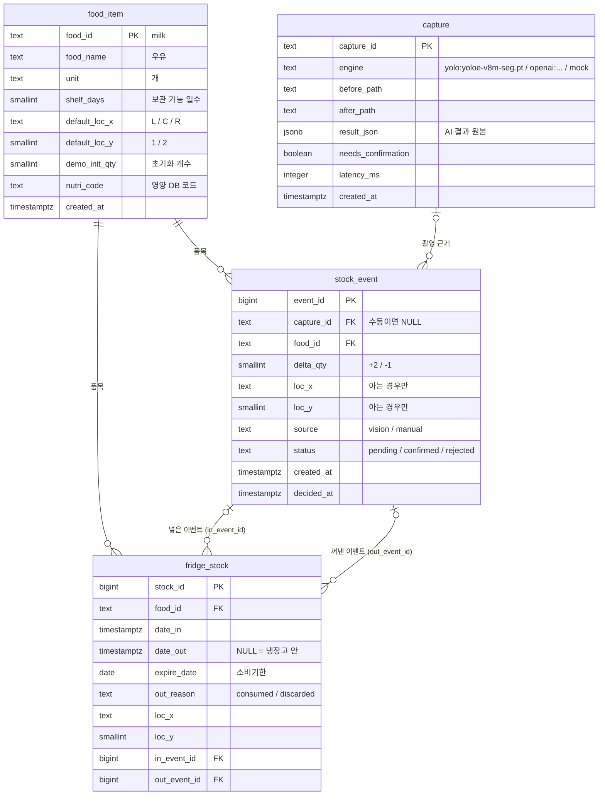

# 고내 식재료 재고 DB 설계 (Supabase)

> 대상: DB·ERD 담당 팀원, 화면(iPad·모니터) 개발자
> 함께 보는 파일: [`supabase/schema.sql`](../supabase/schema.sql) (Supabase SQL Editor에 그대로 붙여넣어 실행)
> 연동 코드: [`supabase_sync.py`](../supabase_sync.py) — 인식 결과를 이 DB에 저장·반영
> 상태: 초안 + fridge_vision 연동 반영 — 표시된 **[결정 필요]** 항목은 팀에서 확정해 주세요.

---

## 1. 한눈에 보기

이 DB가 하는 일은 두 가지입니다.

1. **냉장고 안에 지금 무엇이 몇 개 있는지** 기록합니다.
2. **AI가 인식한 변화가 맞는지 확인한 뒤에만** 재고를 바꿉니다.

```text
카메라 촬영 ─▶ capture(촬영 기록)
                 │
                 ▼
AI 인식 결과 ─▶ stock_event(변경 후보, 상태 = pending)
                 │
       확인 ────────────────────▶ confirm_stock_event() ─▶ fridge_stock(재고) 반영
       거절 ────────────────────▶ reject_stock_event()  ─▶ 재고 그대로
                 │
화면(iPad·모니터) ◀── current_stock(현재 재고 뷰)
```

확인은 지금은 **노트북 프로그램**이 합니다. 확인이 필요 없는 결과는 자동으로, 확인이 필요한 결과는 창에서 `y`/`n`으로 처리합니다. iPad 화면이 생기면 `SUPABASE_CONFIRM_MODE=ipad`로 바꿔 iPad에서 확인하게 할 수 있습니다 (8장).

테이블 4개, 뷰 1개, 함수 3개로 구성됩니다.

| 이름 | 종류 | 한 줄 설명 |
|---|---|---|
| `food_item` | 테이블 | 식재료 목록 25종 (이름, 보관 기간, 기본 위치). 데모 초기 재고는 6종 |
| `capture` | 테이블 | 촬영 1회 = 1행. 사진 경로와 AI 결과 원본 |
| `stock_event` | 테이블 | "우유 +1", "브로콜리 −1" 같은 변경 후보. 확인 전에는 여기에만 있음 |
| `fridge_stock` | 테이블 | 실제 재고. **식재료 1개 = 1행** |
| `current_stock` | 뷰 | 품목별 현재 개수와 가장 가까운 소비기한. 화면은 이것만 읽으면 됨 |
| `confirm_stock_event()` | 함수 | 변경 후보를 확인하고 재고에 반영 |
| `reject_stock_event()` | 함수 | 변경 후보를 거절 |
| `reset_demo()` | 함수 | 데모 초기 상태로 되돌림 |

---

## 2. ERD



**관계 읽는 법**
- 식재료 1종(`food_item`)은 재고 여러 개(`fridge_stock`), 변경 후보 여러 개(`stock_event`)를 가집니다.
- 촬영 1회(`capture`)에서 변경 후보가 여러 개 나올 수 있습니다. 수동 입력은 촬영 없이도 만들 수 있습니다.
- 재고 1개는 **넣을 때의 이벤트**와 **꺼낼 때의 이벤트**를 각각 가리킵니다. 그래서 "이 우유는 언제, 어떤 촬영으로 들어왔다가 나갔나"를 끝까지 추적할 수 있습니다.

---

## 3. 테이블별 설명

### 3-1. `food_item` — 식재료 목록

다른 테이블은 모두 `food_id`로 이 표를 참조합니다. **`food_id`는 인식 코드(`config.ITEMS`)의 item_id와 같아야 합니다.** 목록에 없는 품목은 외래키 때문에 이벤트를 저장할 수 없습니다.

- 처음 6종(우유·두부·달걀·브로콜리·버섯·닭고기)은 데모 초기 재고와 기본 칸이 있습니다.
- 나머지 19종(버터·수박·오렌지·포도·주스 등)은 인식 코드의 품목이라 함께 넣었고, 초기 재고 0, 기본 칸 없음입니다 (YOLOE가 칸을 알려 줌).
- 사용자가 Unknown 물체에 새 이름(예: 올리브오일)을 붙이면 프로그램이 `user_1` 같은 ID로 자동 등록합니다 (`shelf_days` 7 임시값).

| 컬럼 | 타입 | 필수 | 기본값 | 설명 | 예시 |
|---|---|---|---|---|---|
| `food_id` | text | PK | — | 인식 코드가 쓰는 ID와 **반드시 같아야 함** | `milk` |
| `food_name` | text | ✔ | — | 화면에 보일 이름 | `우유` |
| `unit` | text | ✔ | `개` | 단위 | `팩` |
| `shelf_days` | smallint | ✔ | — | 넣은 날부터 보관 가능한 일수 (0보다 커야 함) | `10` |
| `default_loc_x` | text |  | — | 기본 칸. `L`·`C`·`R`만 허용 | `L` |
| `default_loc_y` | smallint |  | — | 기본 층. `1`·`2`만 허용 | `1` |
| `demo_init_qty` | smallint | ✔ | `0` | 데모 초기화 시 넣어 둘 개수 | `1` |
| `nutri_code` | text |  | — | 식약처 영양성분 DB 식품코드 | |
| `created_at` | timestamptz | ✔ | 현재 시각 | 등록 시각 | |

### 3-2. `capture` — 촬영 기록

문이 닫혀 사진을 찍을 때마다 1행이 생깁니다. **AI가 왜 그렇게 판단했는지 근거를 남기는 표**입니다.

| 컬럼 | 타입 | 필수 | 기본값 | 설명 | 예시 |
|---|---|---|---|---|---|
| `capture_id` | text | PK | — | 프로그램이 만드는 촬영 ID (사진 폴더명과 같음) | `capture-20261125-173533-547` |
| `engine` | text | ✔ | — | 어떤 AI로 인식했는지 (result.json 의 `source`) | `yolo:yoloe-v8m-seg.pt` |
| `before_path` | text |  | — | 이전 사진 위치. 지금은 노트북 로컬 경로 | `captures/<id>/before.jpg` |
| `after_path` | text |  | — | 현재 사진 위치 | `captures/<id>/after.jpg` |
| `result_json` | jsonb | ✔ | — | AI 결과 원본 (result.json 그대로) | |
| `needs_confirmation` | boolean | ✔ | `false` | 확인 필요 판정 여부 | `true` |
| `latency_ms` | integer |  | — | AI 응답 시간(밀리초) | `4640` |
| `created_at` | timestamptz | ✔ | 현재 시각 | 촬영 시각 | |

### 3-3. `stock_event` — 재고 변경 후보

AI 결과 중 "무엇이 몇 개 늘고 줄었나"를 저장합니다. **확인 전에는 재고(`fridge_stock`)를 건드리지 않습니다.**
연동 코드는 같은 품목이라도 **칸이 다르면 칸마다 1행**으로 나눠 저장합니다 (예: 오렌지 +2 `R,1` / 오렌지 +1 `R,2`).

| 컬럼 | 타입 | 필수 | 기본값 | 설명 | 예시 |
|---|---|---|---|---|---|
| `event_id` | bigint | PK | 자동 증가 | | `12` |
| `capture_id` | text | FK |  | 어떤 촬영에서 나왔는지. 수동 입력이면 비움 | |
| `food_id` | text | ✔ FK | — | 품목 | `broccoli` |
| `delta_qty` | smallint | ✔ | — | 변화량. 0은 허용 안 함 | `-1` |
| `loc_x`, `loc_y` | text, smallint |  | — | 위치를 아는 경우만 (YOLOE처럼 박스가 나오는 엔진) | `R`, `2` |
| `source` | text | ✔ | `vision` | `vision`(AI) 또는 `manual`(사람·시작 재고 맞추기) | |
| `status` | text | ✔ | `pending` | `pending`(대기) → `confirmed`(확인) 또는 `rejected`(거절) | |
| `created_at` | timestamptz | ✔ | 현재 시각 | | |
| `decided_at` | timestamptz |  | — | 확인·거절한 시각 | |

### 3-4. `fridge_stock` — 냉장고 재고

**식재료 1개가 1행**입니다. 우유가 2개면 2행입니다. 꺼내도 행을 지우지 않고 `date_out`만 채웁니다. 그래서 과거 기록이 그대로 남고, 폐기율 같은 지표를 나중에 계산할 수 있습니다.

| 컬럼 | 타입 | 필수 | 기본값 | 설명 | 예시 |
|---|---|---|---|---|---|
| `stock_id` | bigint | PK | 자동 증가 | | |
| `food_id` | text | ✔ FK | — | 품목 | `milk` |
| `date_in` | timestamptz | ✔ | 현재 시각 | 넣은 시각 | |
| `date_out` | timestamptz |  | — | 꺼낸 시각. **비어 있으면 지금 냉장고 안에 있음** | |
| `expire_date` | date |  | — | 소비기한 = 넣은 날(한국 날짜) + `shelf_days` | `2026-12-05` |
| `out_reason` | text |  | — | `consumed`(먹음) / `discarded`(폐기). `date_out`과 반드시 함께 채워짐 | |
| `loc_x`, `loc_y` | text, smallint |  | — | 놓인 칸 | `C`, `1` |
| `in_event_id` | bigint | FK |  | 넣을 때의 이벤트 (초기화로 넣은 것은 비어 있음) | |
| `out_event_id` | bigint | FK |  | 꺼낼 때의 이벤트 | |

### 3-5. `current_stock` — 현재 재고 (뷰)

화면 개발자는 이 뷰만 읽으면 됩니다. 재고가 0개인 품목도 0으로 나옵니다.

| 컬럼 | 설명 |
|---|---|
| `food_id`, `food_name`, `unit` | 품목 정보 |
| `qty` | 지금 냉장고 안 개수 |
| `nearest_expire` | 그 품목 중 가장 빠른 소비기한 (임박 재료 추천용) |

---

## 4. 꼭 알아야 할 규칙

### 4-1. 위치 좌표 (3×2, 6칸)

정면에서 냉장고를 본 모습입니다.

```text
           L (왼쪽)    C (가운데)   R (오른쪽)
1층 (위)    우유        두부         달걀
2층 (아래)  브로콜리    버섯         닭고기
```

- `loc_x`: `L`, `C`, `R` / `loc_y`: `1`(위 칸), `2`(아래 칸)
- 처음 안에서 "2×2"로 적었던 부분은, 가로가 왼쪽·가운데·오른쪽 3칸이라 **3×2**로 정리했습니다.
- YOLOE 인식 코드는 사진 속 상자 중심이 화면 가로 3등분 중 어디인지(`loc_x`), 세로 경계(`config.FRIDGE_FLOOR_SPLITS`, 기본 화면 절반) 위·아래인지(`loc_y`)로 칸을 정합니다. **부스 카메라를 설치한 뒤 경계를 맞춰야 합니다.**
- GPT 방식은 위치를 모르므로 `food_item`의 기본 위치가 자동으로 들어갑니다. YOLOE처럼 박스가 나오는 엔진은 이벤트에 실제 위치를 넣으면 그 값이 우선합니다.

### 4-2. 꺼낼 때는 먼저 들어온 것부터 (선입선출)

AI는 "우유 2개 → 1개"처럼 **개수만** 알고, 어느 우유가 나갔는지는 모릅니다. 그래서 **가장 먼저 들어온 것을 꺼낸 것으로 처리**합니다. 이 규칙은 `confirm_stock_event()` 안에 들어 있습니다.
YOLOE는 꺼낸 물건의 칸(`loc_x`, `loc_y`)도 이벤트에 기록하지만, 지금 함수는 칸을 보지 않고 선입선출만 적용합니다 ([결정 필요] 6번).

### 4-3. 확인한 것만 재고에 반영

AI 결과는 `stock_event`에 `pending`으로만 저장됩니다. 확인해야 `fridge_stock`이 바뀝니다. 거절하면 재고는 그대로입니다.

### 4-4. 재고보다 많이 빼면 전체 취소

냉장고에 닭고기가 1개인데 "닭고기 −3"을 확인하면 **아무것도 바뀌지 않고 오류**가 납니다. 이벤트는 `pending` 상태로 남습니다. 오인식일 가능성이 높으므로, 화면에서 수정하거나 거절하도록 안내합니다. 연동 코드는 이 오류를 로그로 남기고 다음 작업을 계속합니다.

### 4-5. 먹음과 폐기 구분

꺼낼 때 소비기한이 이미 지났으면 `discarded`(폐기), 아니면 `consumed`(먹음)로 자동 기록됩니다. Performance Tracker의 **폐기 감소** 지표를 이 값으로 계산합니다.

### 4-6. 날짜는 한국 시간 기준

Supabase DB의 기본 시간대는 UTC라서, 소비기한 계산과 폐기 판정은 **한국 날짜(`Asia/Seoul`)** 기준으로 하도록 함수에 넣어 두었습니다. `timestamptz` 컬럼은 내부에 UTC로 저장되고, 화면에서 한국 시간으로 바꿔 보여 주면 됩니다.

---

## 5. 함수 (RPC)

여러 테이블을 한꺼번에 바꾸는 작업은 **반드시 함수로** 합니다. Supabase는 함수 호출 전체를 하나의 트랜잭션으로 실행하므로, 중간에 오류가 나면 전부 취소됩니다.

| 함수 | 입력 | 하는 일 | 반환 |
|---|---|---|---|
| `confirm_stock_event(p_event_id)` | 이벤트 ID | 추가면 개수만큼 재고 행 생성, 제거면 오래된 것부터 `date_out` 기록. 이벤트를 `confirmed`로 | 반영된 개수 |
| `reject_stock_event(p_event_id)` | 이벤트 ID | 이벤트를 `rejected`로 (재고 변화 없음) | 없음 |
| `reset_demo()` | 없음 | 촬영·이벤트·재고 기록을 지우고 `demo_init_qty`만큼 다시 채움 | 채운 개수 |

이미 확인되었거나 거절된 이벤트를 다시 처리하면 오류가 나서, 버튼을 두 번 눌러도 재고가 두 번 바뀌지 않습니다.

---

## 6. 보안 설정 (Supabase 필수)

| 누가 | 어떤 키 | 할 수 있는 것 |
|---|---|---|
| iPad·옆 모니터 화면 | `anon`(공개) 키 | **읽기만** (모든 테이블과 뷰) |
| 노트북 프로그램 (파이썬) | `service_role` 키 | 쓰기 + 함수 실행 |

- 모든 테이블에 RLS(행 단위 보안)를 켜고, 화면용 읽기 정책만 열어 두었습니다.
- **`service_role` 키는 노트북의 `.env`(`SUPABASE_KEY`)에만** 두세요. iPad 코드나 GitHub에 올라가면 누구나 DB를 바꿀 수 있습니다.
- Supabase는 2026년 10월 30일부터 새로 만든 테이블을 API에 **자동으로 열어 주지 않습니다.** 그래서 `schema.sql`에 권한(GRANT)을 명시해 두었습니다. 테이블을 새로 추가할 때도 GRANT와 RLS를 같이 넣어야 합니다. 자동 증가 열의 시퀀스 권한도 `service_role`에 명시했습니다.
- 이 DB에는 개인정보가 없어서 읽기를 모두 열어 두었습니다. **가족 프로필·식사 기록 테이블을 추가할 때는 읽기 정책을 따로 설계해야 합니다.** (KINI 아키텍처: Supabase = 비식별 운영 데이터)

---

## 7. 설치 순서

1. Supabase 대시보드 → **SQL Editor** → New query
2. `supabase/schema.sql` 전체를 붙여넣고 **Run**
3. 확인 쿼리를 실행해 25개 품목이 보이면 성공입니다. 우유 0, 두부·달걀·브로콜리·버섯·닭고기 1, 나머지 0이 나와야 합니다.
   ```sql
   select * from current_stock order by food_id;
   ```
4. **Table Editor**에서 테이블 4개 모두 RLS가 켜져 있는지 확인합니다.
5. **Project Settings → API**에서 Project URL과 `service_role` 키를 복사해 노트북의 `.env`에 넣습니다.
   ```text
   SUPABASE_URL=https://프로젝트ID.supabase.co
   SUPABASE_KEY=<service_role 키>
   SUPABASE_CONFIRM_MODE=local
   ```

다시 만들어야 할 때는 아래를 먼저 실행하고 2번부터 반복합니다.

```sql
drop view if exists public.current_stock;
drop function if exists public.confirm_stock_event(bigint), public.reject_stock_event(bigint), public.reset_demo();
drop table if exists public.fridge_stock, public.stock_event, public.capture, public.food_item;
```

---

## 8. 노트북 프로그램(파이썬) 연동 — `supabase_sync.py`

추가 라이브러리 없이 Supabase REST API를 `requests`로 직접 호출합니다 (supabase-py 와 같은 요청).

| 프로그램 시점 | DB 작업 |
|---|---|
| 인식 결과가 나옴 | `capture` 1행 + `stock_event` (pending) 품목·칸별 1행 |
| 재고에 반영 (확인 필요 없음 → 자동, 또는 창에서 `y`) | 그 촬영의 pending 이벤트마다 `confirm_stock_event()` |
| 거절 (창에서 `n`) | `reject_stock_event()` |
| 영상 파일로 시험할 때 첫 촬영 | DB 재고(`current_stock`)를 카메라가 본 before 개수에 맞춤. 차이만큼 `source='manual'` 이벤트를 만들고 바로 확인 |
| 목록에 없는 품목 (사용자가 새 이름을 붙임) | `food_item`에 자동 등록 후 이벤트 저장 |

- **iPad에서 확인하려면** `.env`의 `SUPABASE_CONFIRM_MODE=ipad`로 바꿉니다. 그러면 프로그램은 pending 이벤트만 저장하고, iPad가 `confirm_stock_event` / `reject_stock_event`를 호출합니다 (iPad는 anon 키라 함수 실행 권한이 없으므로, 노트북 서버를 거쳐 호출해야 합니다 — [결정 필요] 5번).
- 전송은 별도 스레드에서 순서대로 합니다. 네트워크·서버 오류(5xx)면 작업을 `captures/supabase_queue.jsonl`에 보관했다가 다음 동기화 때 먼저 보냅니다.
- 모든 작업은 다시 보내도 결과가 같습니다: `capture`는 중복을 무시하고, 이벤트는 같은 `capture_id`로 이미 저장돼 있으면 다시 만들지 않으며, pending 이 아닌 이벤트는 다시 확인하지 않습니다.
- 재고 부족(stock mismatch) 같은 4xx 오류는 다시 보내도 같으므로 보관하지 않고 로그만 남깁니다. 이벤트는 pending 으로 남습니다.
- 사진 파일은 올리지 않고 경로 문자열만 저장합니다.

supabase-py로 같은 일을 하면 다음과 같습니다 (참고).

```python
from supabase import create_client
sb = create_client(SUPABASE_URL, SUPABASE_SERVICE_ROLE_KEY)
sb.table("capture").insert({"capture_id": cid, "engine": "yolo:yoloe-v8m-seg.pt",
                            "result_json": result, "needs_confirmation": False}).execute()
events = sb.table("stock_event").insert([
    {"capture_id": cid, "food_id": "orange", "delta_qty": -1, "loc_x": "R", "loc_y": 1},
]).execute().data
for e in events:
    sb.rpc("confirm_stock_event", {"p_event_id": e["event_id"]}).execute()
stock = sb.table("current_stock").select("*").execute().data
```

---

## 9. 처음 안(Oracle)에서 바뀐 점

| 처음 안 | 바뀐 설계 | 이유 |
|---|---|---|
| `FOOD_NAME` (자유 문자열) | `food_id` → `food_item` 참조 | "우유·흰우유·milk"처럼 같은 식재료가 갈라지는 것 방지 |
| `LOC` "X,Y" 한 칸 | `loc_x`, `loc_y` 두 칸 + 허용값 제한 | 조회·검증이 쉬움. 3×2 격자로 정리 |
| `FOOD_DATE_IN/OUT` | `date_in`, `date_out` (timestamptz) | PostgreSQL 이름 규칙(소문자_밑줄), 시간대 포함 |
| 없음 | `expire_date`, `out_reason` | 임박 재료 추천, 폐기 감소 지표 |
| 없음 | `capture`, `stock_event` 테이블 | 확인 전 결과 분리, 오류 판단 근거 보관 |
| VARCHAR2, Oracle 시퀀스 | text, `generated always as identity` | PostgreSQL 문법 |

### 팀 초안 `schema.sql`에서 연동을 위해 바꾼 점

| 바꾼 점 | 이유 |
|---|---|
| `food_item`에 인식 품목 19종 추가 (초기 재고 0, 기본 칸 없음, `shelf_days` 임시값) | 시연 영상의 오렌지·버터·수박·포도·주스 등이 외래키 때문에 저장되지 않음 |
| `service_role`에 자동 증가 시퀀스 사용 권한 명시 | 서버가 `stock_event`를 넣을 때 필요 (Supabase 기본 권한에 기대지 않음) |
| `stock_event (capture_id)` 인덱스 추가 | 재전송 시 같은 촬영의 이벤트를 찾는 조회 |
| 파일 끝에 확인 쿼리 주석 | 설치 확인용 |

테이블·함수·권한·RLS 정책은 팀 초안과 같습니다.

---

## 10. [결정 필요] 팀에서 정할 것

1. **`shelf_days` 값:** 처음 6종(우유 10, 두부 7, 달걀 21, 브로콜리 5, 버섯 5, 닭고기 2일)과 추가 19종(버터 30, 수박 3, 오렌지 14, 사과·레몬 21, 토마토 7, 딸기 3, 포도 5, 당근 14, 오이 7, 양배추 14, 대파 7, 치즈 14, 요거트 10, 햄 7, 김치 30, 주스 7, 생수·캔 180일) 모두 **임시값**입니다. 근거 자료를 찾아 확정해 주세요.
2. **층 번호:** 1 = 위 칸, 2 = 아래 칸으로 정했습니다. 인식 코드도 같은 규칙입니다 (`config.FRIDGE_FLOOR_NUMBER_FROM_TOP = True`). 반대로 쓰려면 둘 다 바꾸세요.
3. **같은 칸에 같은 품목이 여러 개일 때:** 지금은 칸 단위로만 기록합니다. 더 세밀한 위치가 필요하면 좌표 컬럼을 추가해야 합니다.
4. **화면 동기화 방식:** Supabase Realtime을 쓰면 재고가 바뀔 때 iPad·모니터가 자동으로 갱신되어, Socket.IO를 대체할 수 있습니다. 쓸지 말지를 정해 주세요.
5. **확인 주체:** 지금은 노트북 프로그램이 확인합니다(`local`). iPad에서 확인한다면 iPad는 anon 키(읽기 전용)이므로, 확인 버튼이 노트북 서버의 API를 거쳐 함수를 호출하는 구조가 필요합니다.
6. **꺼낼 때 칸 반영:** YOLOE는 꺼낸 물건의 칸을 알려 주지만 `confirm_stock_event()`는 선입선출만 봅니다. 칸이 같은 행을 먼저 꺼내도록 바꿀지 정해 주세요.
7. **시작 재고 맞추기:** 영상 파일 시험 때는 첫 촬영 before 로 DB 재고를 맞춥니다 (`SUPABASE_BASELINE_ON_START = "auto"`). 부스 카메라는 `reset_demo()`로 실제 냉장고와 맞춰 두고 시작한다고 가정했습니다.
8. **사진 저장 위치:** Supabase Storage에 올릴지, 노트북 로컬에만 둘지 정해 주세요. 지금은 로컬 경로만 저장합니다.

---

## 11. 검증 결과

### 팀 초안 검증 (DB 담당)
`schema.sql`은 PostgreSQL 16에 Supabase와 같은 역할(`anon`, `authenticated`, `service_role`)을 만들어 실행해 보았고, 아래 시나리오가 모두 의도대로 동작했습니다.

| 시나리오 | 결과 |
|---|---|
| 우유 +1, 브로콜리 −1 확인 | 우유 1, 브로콜리 0 |
| 두부 +2 후 −1 | 가장 먼저 들어온 두부가 나감 (선입선출) |
| 재고 1개인 닭고기 −3 확인 | 오류, 재고·이벤트 그대로 |
| 거절한 이벤트를 다시 확인 | 오류, 재고 변화 없음 |
| 소비기한 지난 버섯 제거 | `discarded`로 기록 |
| `anon` 키로 쓰기·초기화 시도 | 권한 거부 |
| `reset_demo()` | 초기 상태로 복원 |

### 연동 검증 (`tests/test_supabase_sync.py`)
수정한 `schema.sql`을 실제 PostgreSQL(pgserver)에 그대로 실행하고, Supabase REST 요청을 SQL로 바꿔 `service_role`/`anon` 역할로 실행하는 시험 서버로 연동 코드를 확인했습니다.

| 시나리오 | 결과 |
|---|---|
| 설치 직후 | 품목 25종, 두부·달걀·브로콜리·버섯·닭고기 1 |
| 첫 결과 저장 (영상 시험) | 시작 재고를 before 에 맞춤(manual 11건, 칸별 분리) + capture 1행 + 오렌지 −1 pending. 재고는 아직 그대로 |
| 확인 | 오렌지 3 → 2, 이벤트 confirmed. 같은 확인을 다시 보내도 두 번 반영되지 않음 |
| 재고보다 많이 빼기 (수박 −3) | 함수가 거부, 이벤트 pending 유지, 재고 그대로 |
| 거절 (우유 +1) | rejected, 재고 변화 없음 |
| 새 품목 (`user_1` 올리브오일) | `food_item` 자동 등록 후 반영, 칸 `L,2` 기록 |
| 네트워크 장애 | 작업 2개 보관 → 복구 후 순서대로 재전송, 사과 +2 반영 |
| `anon` 키 | 읽기 성공, 이벤트 쓰기·`reset_demo()` 실행 거부(401) |
| **h265 영상 전체 실행** (`main.py`) | capture 1행(4640ms), 이벤트 12건 모두 confirmed, 오렌지 1개 consumed. 최종 버터 1·수박 1·오렌지 2·포도 1·주스 2 |

- 시험용 PostgreSQL(Windows pgserver)에는 시간대 데이터가 없어 `'Asia/Seoul'`을 같은 뜻인 `+09:00`으로 바꿔 실행했습니다 (한국은 서머타임 없음). Supabase에서는 `schema.sql`을 그대로 씁니다.
- **실제 Supabase 프로젝트에서는 아직 실행해 보지 않았습니다.** 처음 실행할 때 오류가 나면 메시지를 공유해 주세요.
